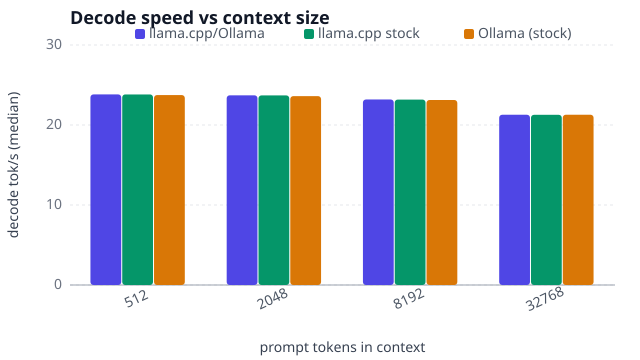
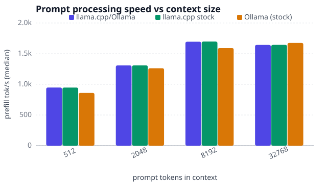
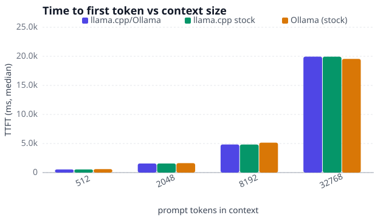
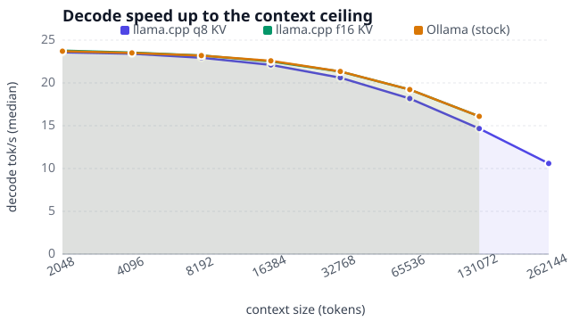
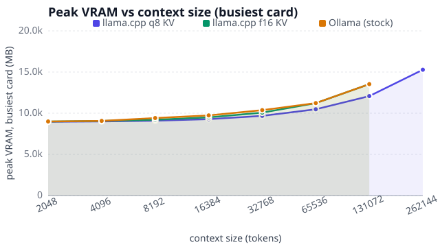
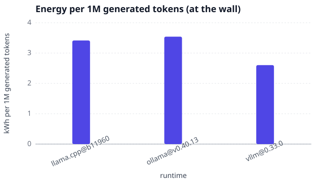
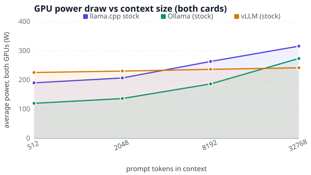
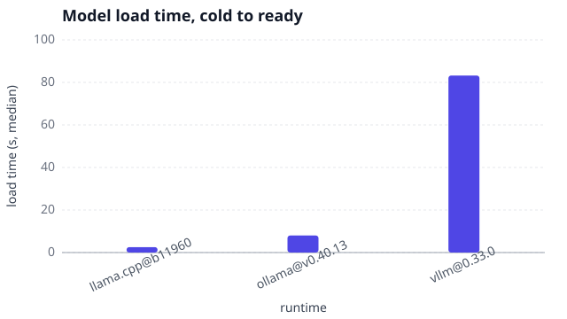
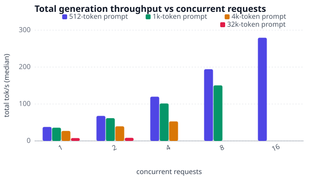
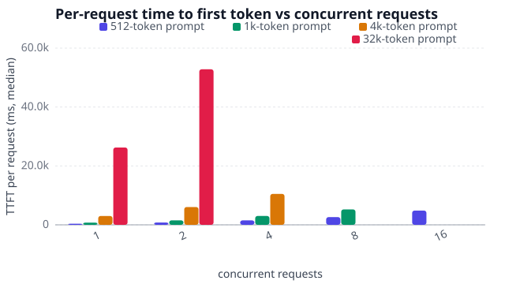

On two NVIDIA GeForce RTX 5060 Ti cards, qwen3.5-27b holds a 230k-token context with stock llama.cpp. Give it a short prompt and it writes 24 tokens per second.

We ran qwen3.5-27b with three runtimes, llama.cpp, Ollama and vLLM without tuning their parameters. We measured generation speed, prompt processing, the wait for the first token, the context ceiling, memory, power at the wall socket and serving many users at once. This is the full-data companion to our shorter 5-minute article, with the exact test bench described at the end.

As a medium-sized dense model, qwen3.5-27b is a candidate for analysis and general-knowledge tasks.

## Straight to the Results

Every number below was measured on stock llama.cpp, and each row gets its own deep dive further down.

| Metric | 512 Context | 8k Context | 32k Context | Max Context (230k) |
| --- | --- | --- | --- | --- |
| Prompt Processing (tok/s) | 947 | 1697 | 1644 | 867 |
| TTFT | 541 ms | 4.8 s | 20 s | 4.4 min |
| Generation (tok/s) | 24 | 23 | 21 | 13 |

Wall energy use was 3.4 kWh per 1M generated tokens, costing about 0.85 € at 0.25 €/kWh.

## The Verdict

qwen3.5-27b is a viable local model on an enthusiast computer with two NVIDIA GeForce RTX 5060 Ti cards, with a trade-off between generation speed and context capacity.

- Speed: the first token arrives in **541 ms** at best; generation falls from 24 tok/s to **13 tok/s** at the 230k-token ceiling.
- Runtimes: on a short prompt, Ollama delivers 24 tok/s with a 595 ms TTFT, versus 24 tok/s and 541 ms for llama.cpp; vLLM achieves a **380 ms** TTFT and **279 tok/s** in total across 16 simultaneous requests.
- Memory: the full 230k-token context peaks at **16 GB** on the busiest card with the default f16 KV cache, versus **15 GB** with q8_0.
- Energy: wall energy per 1M generated tokens is 3.4 kWh with llama.cpp, 3.5 kWh with Ollama, and **2.6 kWh** with vLLM.

## The Main Event: Generation Speed

How quickly does qwen3.5-27b write its answers, and does it slow down as the prompt gets longer? The chart compares Ollama out of the box with llama.cpp in two setups: its default settings and the exact settings Ollama passes to it, all using the exact same model file. Full configuration details are in the appendix at the end.

At 512 tokens, both stock runtimes round to 24 tok/s, with llama.cpp ahead by just **0.080 tok/s** (0.34%). Stock llama.cpp drops to 23 tok/s at 8k context and 21 tok/s at 32k, losing **2.5 tok/s** (11%) from its 512-token result. At 32k, Ollama leads by only 0.0090 tok/s, so the runtime gap remains negligible beside the context-related slowdown. With Ollama’s flags, llama.cpp lands within 0.0010 tok/s of stock llama.cpp, pointing to Ollama itself rather than its flags as the source of the small difference.

## The Prefill Phase: Reading Speed

Before a model can write anything, it first has to read the prompt, a step called prefill. How quickly it does this determines how long you wait for the answer to begin, which matters especially with long inputs. The chart compares this reading speed across the same configurations as above.

Stock llama.cpp rises from 947 tok/s at 512 tokens to a measured peak of **1697 tok/s** at 8k tokens, then eases to 1644 tok/s at 32k tokens. Ollama starts lower at 860 tok/s for 512 tokens but peaks later, reaching 1676 tok/s at 32k tokens, its deepest measured point. Stock llama.cpp shows only mild degradation through 32k tokens, but falls to **867 tok/s** at its 230k-token maximum; Ollama has no measurements beyond 32k tokens to establish its deeper-context degradation.

## The Wait: Time to First Token

Time to first token, or TTFT, is the wait between hitting enter and seeing the first word appear. It is what makes a model feel snappy or sluggish, and it grows with longer prompts because the model must process the whole prompt before it can start answering.

Stock llama.cpp’s median TTFT rises from **541 ms** at 512 tokens to 1.6 s at 2k tokens, 4.8 s at 8k tokens, and 20 s at 32k tokens. At its maximum prompt of 230k tokens, TTFT reaches **4.4 min**. Ollama takes 595 ms at 512 tokens, a 55 ms penalty, widening to 320 ms at 8k tokens. The gap is therefore neither a fixed cost nor a consistently growing penalty: at 32k tokens, Ollama reverses the ordering, finishing 382 ms faster, although both runtimes round to 20 s.

## Pushing Context to the Limit

Context is how much text a model can hold at once. We kept doubling it until the two graphics cards ran out of memory or the model reached its own limit. The chart shows how generation speed holds up as context grows, comparing llama.cpp with its default memory cache, llama.cpp with a compressed cache, and Ollama.

Stock llama.cpp reached **230k tokens**; the probe’s `{max_context_capped}` stop indicates the model’s own context ceiling, not an out-of-memory failure. The q8_0 KV cache reached **260k tokens**, while Ollama reached 130k tokens. At the stock ceiling, decoding sustained 13 tok/s after a 4.4 min TTFT: generation remained steady at depth, but only after a long initial wait. The q8_0 cache bought more context at the cost of lower decode throughput, 11 tok/s, and a longer 5.8 min TTFT at its ceiling.

## The Memory Wall

Each graphics card has its own fixed amount of memory, and the model and its context are spread across both cards. Every extra token of context uses a little more memory: this chart shows how much on the busiest card, and how compressing the KV cache, which stores information from earlier tokens, leaves more room.

On the busiest of the two 16311 MB cards, stock llama.cpp rises from 8992 MB at 512 tokens to 16272 MB at its 230k-token ceiling, leaving just **39 MB** free. The q8_0 KV cache peaks at 15280 MB at 260k tokens, leaving **1031 MB** free, or 992 MB more headroom despite the larger context. Stock therefore shows substantial VRAM growth with context; q8_0’s lower endpoint is consistent with a gentler curve, although its slope cannot be calculated from the single supplied measurement. At 260k tokens, q8_0 completes while stock llama.cpp fails with launch OOM.

## Energy & What It Costs

Every token generated uses electricity, so we measured that use at the wall socket with a smart plug, capturing the whole computer rather than just the graphics cards. The chart compares how much energy each runtime needs to generate the same amount of text.

Stock llama.cpp uses **3.4 kWh per 1M generated tokens** at the wall, compared with 3.5 kWh for Ollama and **2.6 kWh** for vLLM on the same basis. During the 8k-token-prompt llama.cpp run, average wall draw was 373 W. The llama.cpp energy total breaks down into 2.3 kWh per 1M tokens for both GPUs together, 0.25 kWh for the CPU package and 0.89 kWh for the rest of the system, including power supply losses, RAM, fans and drives. At 0.25 €/kWh, that amounts to about 0.85 € per 1M generated tokens.

## How Hard the GPU Works

Each graphics card has a stock power limit of 150 W, so together they can draw up to 300 W. How close a runtime gets to that limit shows how hard it makes the cards work, which affects heat, fan noise and the power bill. The chart tracks the combined average power draw of both cards as the prompt grows, for each runtime.

Against the pair’s **300 W** combined limit, llama.cpp rises from 191 W at the shortest prompt to **317 W** at the longest, working the cards hardest at the longest prompt and exceeding the stated limit. Ollama increases from 121 W to 275 W, approaching but remaining below the limit. vLLM draws the most at the shortest prompt, at 226 W, but reaches only 243 W at the longest, staying comfortably below 300 W.

## Cold Start: From Disk to First Word

Before it can answer anything, the model has to be loaded from disk into the two graphics cards: this is the cold start. That wait matters for services that unload the model when idle, because they must load it again when a new request arrives. The chart compares how long each runtime takes to get ready.

Cold-start loading takes 2.5 s for stock llama.cpp, 8.0 s for Ollama and **83 s** for vLLM. Once loaded, TTFT after a 512-token prompt is lowest on vLLM at **380 ms**, versus 541 ms for llama.cpp and 595 ms for Ollama. For on-demand serving, llama.cpp’s 2.5 s load is the strongest result; for a model kept warm, vLLM’s 380 ms TTFT gives it the advantage on this prompt.

## Serving Many Users at Once: vLLM

Everything so far measured one request at a time, but a model serving a team or an application must handle many requests at once. That is the job of vLLM, a server runtime used in production deployments: it interleaves requests through the GPUs rather than making each wait its turn, a technique called continuous batching, and here it splits the model evenly across both cards. One caveat: vLLM uses a different compressed model file (awq-AWQ-4bit) from llama.cpp and Ollama (gguf-Q4_K_M), so this compares complete setups, not just programs.

On a single request with a 512-token prompt, vLLM leads stock llama.cpp in prefill at 1349 versus 947 tok/s, yielding a TTFT of 380 versus 541 ms. At 32k tokens, llama.cpp leads prefill instead, with a TTFT of 20 s versus vLLM’s 26 s. vLLM leads decode at both lengths: 40 versus 24 tok/s at 512 tokens and 37 versus 21 tok/s at 32k tokens. The operational costs are a cold start of **83 s** versus **2.5 s**, plus vLLM’s up-front pre-allocation of up to **15 GB** of each card’s **16 GB**, regardless of prompt length.

With stock settings, vLLM reaches **66k tokens**, compared with **230k tokens** for stock llama.cpp on the same two graphics cards. A `runtime_crash` probe outcome means the server failed to start at the tested context size; it does not establish why.

With 512-token prompts, total generation throughput rises from **38 tok/s** at 1 request to **279 tok/s** at 16 concurrent requests, while per-stream decode falls from 40 tok/s to 26 tok/s. Longer prompts retain less batching benefit: 1024-token prompts rise from 36 tok/s to 150 tok/s at 8 concurrent requests, while 4096-token prompts rise from 27 tok/s to 53 tok/s at 4 concurrent requests. At 32768-token prompts, throughput barely improves, moving from 7.7 tok/s to 8.4 tok/s at 2 concurrent requests. For 512-token prompts, wall draw increases only from 341 W to 352 W as throughput multiplies by 7.4×, reducing the energy cost per generated token under load.

At 512-token prompts, median time to first token (TTFT) rises from **380 ms** alone to **4.8 s** at 16 concurrent requests, a clearly noticeable shift from a subsecond response to a multisecond wait. Longer prompts make the delay more pronounced: median TTFT increases from 750 ms to 5.2 s for 1024-token prompts at 8 concurrent requests, and from 3.0 s to 11 s for 4096-token prompts at 4 concurrent requests. At 32768 tokens, even a single request waits 26 s for its first token, rising to 53 s with just 2 concurrent requests.

## Appendix: Test Bench & Method

The hardware stays the same throughout the series so results remain comparable between models. Every runtime runs exactly as installed, with no tuning. Power is measured at the wall socket with a smart plug, covering the whole box rather than just the GPUs. llama.cpp and Ollama decide on their own how to spread the model over the two cards, while vLLM splits it evenly across both using tensor parallelism.

| Component | Specification |
|---|---|
| cpu | Intel Core Ultra 7 265K |
| motherboard | ASUS ROG MAXIMUS Z890 APEX Hovedkort - Intel Z890 |
| ram | Kingston FURY Beast DDR5-5600 - 64GB |
| gpu | 2 × MSI GeForce RTX 5060 Ti (16 Gb GDDR7 each, 32 Gb in total) |
| system | Linux 7.0.0-38-generic |
| nvidia driver | 615.71.09 |
| llama.cpp version | llama.cpp@b11960 |
| ollama version | ollama@v0.40.13 |
| vllm version | vllm@0.33.0 |
| model artifact (llama.cpp, Ollama) | gguf-Q4_K_M |
| model artifact (vLLM) | awq-AWQ-4bit |

## Appendix: The Contenders

We ran the same model in several configurations: Ollama as installed, stock llama.cpp, llama.cpp with Ollama’s exact flags, and llama.cpp with a compressed q8_0 KV cache to make room for longer inputs. We also tested vLLM split across both graphics cards, with and without an fp8 KV cache. The table below lists every configuration and the flags it changes; “stock” means the runtime’s own defaults.

| Role | Runtime | Flags |
| --- | --- | --- |
| best:kv_type=q8_0 | `llama.cpp@b11960` | `-fa on -ctk q8_0 -ctv q8_0` |
| reference:ollama-defaults | `llama.cpp@b11960` | `-fa auto -ctk f16 -ctv f16 -b 512 -ub 512 -t 4` |
| baseline | `llama.cpp@b11960` | stock |
| defaults | `ollama@v0.40.13` | stock |
| baseline | `vllm@0.33.0` | `--tensor-parallel-size 2` |

## Further Reading

Read the [short 5-minute article about this model](#short-article), revisit the [previous article in the series](#previous-article)
