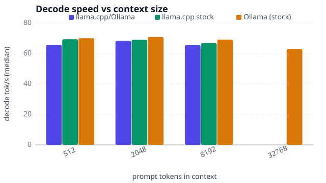
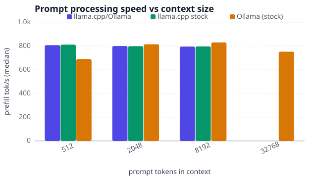
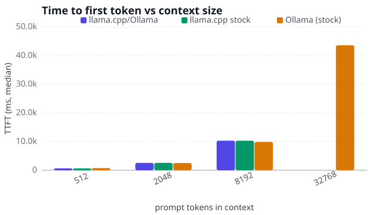
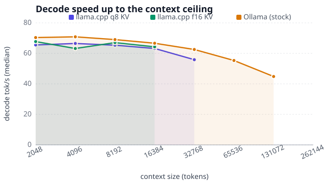
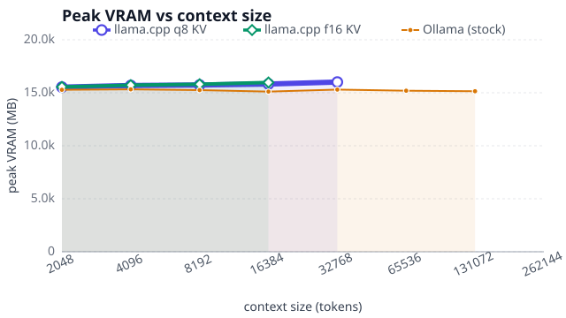
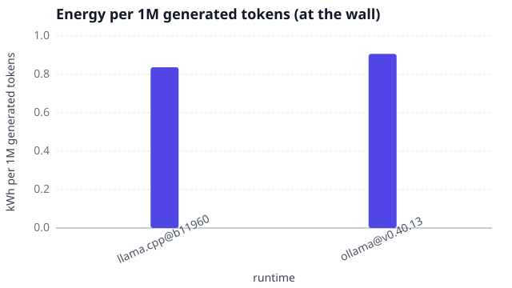
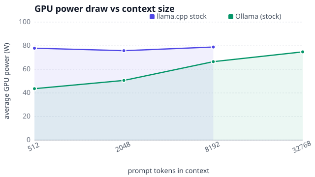
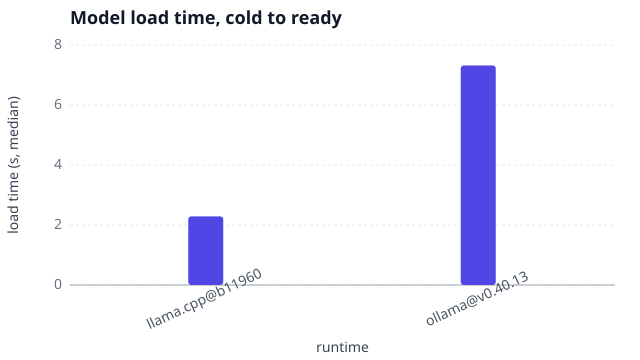

On an NVIDIA GeForce RTX 5060 Ti, qwen3.5-35b-a3b generates 69 tokens per second from a short prompt using stock llama.cpp. It also fits a 31k-token context on that same card.

We ran qwen3.5-35b-a3b with three runtimes, llama.cpp, Ollama and vLLM, without tuning. We measured generation speed, prompt processing, the wait for the first token, the context ceiling, memory use, power at the wall socket and performance when serving many users at once. This is the full-data companion to our shorter 5-minute article, with the exact test bench described at the end.

As a mixture-of-experts model, qwen3.5-35b-a3b is a candidate for memory-constrained systems and more specialized work.

## Straight to the Results

Every number below was measured on stock llama.cpp, and each row gets its own deep dive further down.

| Metric                    | 512 Context | 8k Context | 32k Context (ollama) | Max Context (30720) |
| ------------------------- | ----------- | ---------- | ----------------------- | ------------------- |
| Prompt Processing (tok/s) | 811         | 796        | 741                     | 746                 |
| TTFT                      | 631 ms      | 10 s       | 43.5 s                  | 41 s                |
| Generation (tok/s)        | 69          | 67         | 63                      | 62                  |

Energy at the wall: 0.84 kWh per 1M generated tokens, about 0.21 € at 0.25 €/kWh.

## The Verdict

qwen3.5-35b-a3b is a fast local option for a budget computer with an NVIDIA GeForce RTX 5060 Ti, but its full-context memory footprint is substantial.

- Speed: The first token arrives in **631 ms** at best; generation falls from 69 tok/s to **62 tok/s** at the 31k-token ceiling.
- Runtimes: On a short prompt, Ollama generates **70 tok/s** with a 742 ms TTFT, versus 69 tok/s and **631 ms** for llama.cpp. vLLM latency, concurrency, and total throughput measurements were not provided.
- Memory: Full-context peak usage is **16 GB** with either the default f16 KV cache or q8_0, showing no measured reduction.
- Energy: Wall energy per 1M generated tokens is **0.84 kWh** with llama.cpp and **0.91 kWh** with Ollama. The vLLM measurement was not provided.

## The Main Event: Generation Speed

How quickly does qwen3.5-35b-a3b write its answers, and does a longer prompt slow it down? The chart compares Ollama out of the box with llama.cpp in its stock setup and with the exact flags Ollama passes, all running the exact same model file. Full configuration details are in the appendix at the end.

At 512 tokens, stock llama.cpp delivers 69 tok/s versus Ollama’s 70 tok/s, a gap of just **0.65 tok/s**. At 8k tokens, llama.cpp falls to 67 tok/s versus Ollama’s 69 tok/s, widening the gap to **2.3 tok/s** as the runtimes lose 3.7% and 1.3% of their initial speed, respectively. At 32k tokens, Ollama reaches 63 tok/s, down 10% from 512 tokens; the corresponding llama.cpp measurement is missing, preventing comparison. With Ollama’s flags, llama.cpp reaches 66 tok/s at 512 tokens, below both stock results rather than matching either, so those flags do not explain Ollama’s advantage.

## The Prefill Phase: Reading Speed

Before a model can write an answer, it first has to read your prompt, a step called prefill. How quickly it does this determines how long you wait for the answer to begin, which matters especially with long inputs. The chart compares this reading speed across the same configurations as above.

Stock llama.cpp peaks at **811 tok/s** with 512 prompt tokens, slips to 796 tok/s at 8k tokens, and declines gradually to 746 tok/s at its 30720-token maximum. Ollama starts lower at 690 tok/s with 512 tokens, peaks at **830 tok/s** with 8k tokens, then falls to 752 tok/s at 32k tokens. No stock llama.cpp measurement is supplied at 32k tokens, so a matched-depth comparison there is unavailable.

## The Wait: Time to First Token

Time to first token, or TTFT, is the wait between hitting enter and seeing the first word appear. That wait makes a model feel snappy or sluggish, and it grows with longer prompts because the model must process the whole prompt before it can start answering.

Stock llama.cpp TTFT rises roughly with prompt length: 631 ms at 512 tokens, 2.6 s at 2k tokens, and 10 s at 8k tokens. It reaches **41 s** at the reported 30720-token maximum, but no stock measurement is supplied for 32k tokens. Ollama records 742 ms at 512 tokens and **44 s** at 32k tokens, while its intermediate results of 2.5 s at 2k tokens and 9.9 s at 8k tokens slightly beat stock llama.cpp. The gap therefore neither stays a fixed cost nor grows consistently with prompt length; the missing stock result at 32k tokens prevents a matched comparison at that endpoint.

## Pushing Context to the Limit

Context is how much text a model can hold at once, including what you give it and what it generates. We kept doubling that amount until the graphics card ran out of memory or the model reached its own limit. The chart shows how generation speed holds up along the way, comparing llama.cpp with its default memory cache, llama.cpp with a compressed cache, and Ollama.

Stock llama.cpp reaches 31k tokens, where `{max_context_capped}` and `param_space.hi` indicate the model’s configured context ceiling, not an out-of-memory failure. The q8_0 KV cache extends the measured limit to 55k tokens, but decode throughput falls from **62 tok/s** to **51 tok/s**. In practice, generation continues at 51 tok/s at that deeper context, but the wait before the first token increases from 41 s to 77 s. Ollama reaches 131k tokens; its timeout at 262k tokens leaves the ceiling beyond that successful run unresolved.

## The Memory Wall

Your graphics card has a fixed amount of memory, and every extra token in the model’s context uses a little more of it. This chart shows how that memory use grows and how compressing the KV cache, the model’s working memory for the conversation, leaves room for more context.

Stock llama.cpp’s VRAM curve rises gradually from 15560 MB at 512 tokens to 16264 MB at its 31k-token ceiling. The q8_0 KV-cache curve is shallower, reaching the same 16264 MB peak at **55k tokens**. That buys roughly **80%** more context, or 25k additional tokens, on the 16 GB card, but not spare VRAM: both configurations finish just 47 MB below its 16311 MB capacity.

## Energy & What It Costs

Every token an AI model generates uses electricity, so we measured that energy at the wall socket with a smart plug, capturing the whole computer rather than just the graphics card. The chart compares the electricity each runtime uses to generate the same amount of text.

Stock llama.cpp consumes **0.84** kWh per 1M generated tokens at the wall, versus **0.91** kWh for Ollama; the vLLM value was not supplied. The llama.cpp total comprises 0.37 kWh for the GPU, 0.13 kWh for the CPU package and 0.34 kWh for the rest of the system, including power supply losses, RAM, fans and drives. Average wall draw during the 8k-token-prompt llama.cpp run is 179 W. At 0.25 €/kWh, llama.cpp’s measured wall energy costs about 0.21 € per 1M generated tokens.

## How Hard the GPU Works

The graphics card has a stock power limit of 180 W. How close each runtime gets to that limit shows how hard it makes the card work, affecting heat, fan noise and the power bill. The chart tracks the card’s average power draw as the prompt grows, with each runtime shown separately.

llama.cpp averages 78 W at its shortest prompt and **79 W** at its longest, both well below the card’s 180 W limit. Ollama draws 44 W and 75 W at its shortest and longest prompts, respectively, also below 180 W. llama.cpp works the card hardest at both endpoints, but neither runtime approaches the limit: the highest measured average is **79 W**, versus 180 W available.

## Cold Start: From Disk to First Word

Before it can give its first answer, the model must be loaded from disk into the graphics card, a step called a cold start. This wait matters for services that unload the model when idle, because they must load it again when a new request arrives. The chart compares how long each runtime takes to get ready.

Stock llama.cpp loads in **2.3 s**, compared with **7.3 s** for Ollama; vLLM’s load time remains unspecified. Once loaded, TTFT for a 512-token prompt is 631 ms on llama.cpp and 742 ms on Ollama, with vLLM’s TTFT also unspecified. On-demand serving therefore adds a 2.3 s or 7.3 s loading delay, respectively, that keeping the model warm avoids.

## Serving Many Users at Once: vLLM

The vLLM concurrency benchmark was omitted because loading the model in vLLM exceeds the 16 GB VRAM capacity of a single RTX 5060 Ti.

## Appendix: Test Bench & Method

The hardware stays the same throughout the series so results remain comparable between models. Every runtime runs exactly as installed, with no tuning. Power is measured at the wall socket with a smart plug, covering the whole computer, not just the GPU.

| Component | Specification |
|---|---|
| cpu | Intel Core Ultra 7 265K |
| motherboard | ASUS ROG MAXIMUS Z890 APEX Hovedkort - Intel Z890 |
| ram | Kingston FURY Beast DDR5-5600 - 64GB (32 Gb) |
| gpu | MSI GeForce RTX 5060 Ti (16 Gb GDDR7) |
| system | Linux 7.0.0-38-generic |
| nvidia driver | 615.71.09 |
| llama.cpp version | llama.cpp@b11960 |
| ollama version | ollama@v0.40.13 |
| vllm version | {vllm_version} |
| model artifact (llama.cpp, Ollama) | gguf-Q4_K_M |
| model artifact (vLLM) | {vllm_artifact} |

## Appendix: The Contenders

We ran the same model with Ollama as installed, stock llama.cpp, llama.cpp using Ollama’s exact flags, and llama.cpp with a compressed q8_0 KV cache to make room for longer inputs. We also tested stock vLLM and its fp8 KV-cache variant. The table below lists every configuration and the flags it changes; “stock” means each runtime’s own defaults.

| Role | Runtime | Flags |
| --- | --- | --- |
| best:kv_type=q8_0 | `llama.cpp@b11960` | `-fa on -ctk q8_0 -ctv q8_0` |
| reference:ollama-defaults | `llama.cpp@b11960` | `-fa auto -ctk f16 -ctv f16 -b 512 -ub 512 -t 4` |
| baseline | `llama.cpp@b11960` | stock |
| defaults | `ollama@v0.40.13` | stock |

## Further Reading

For a quick overview, read the [5-minute article about this model](MODEL_OVERVIEW_URL).

Continue exploring with the [previous article in the series](PREVIOUS_ARTICLE_URL) or the [next article in the series](NEXT_ARTICLE_URL).
