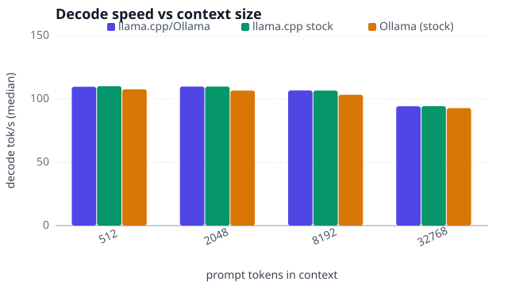
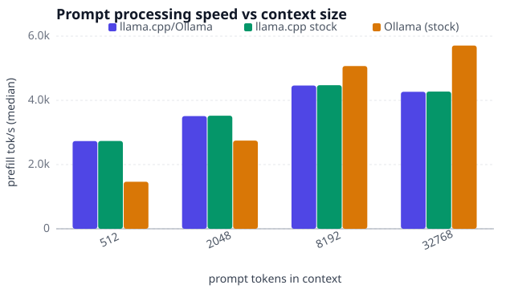
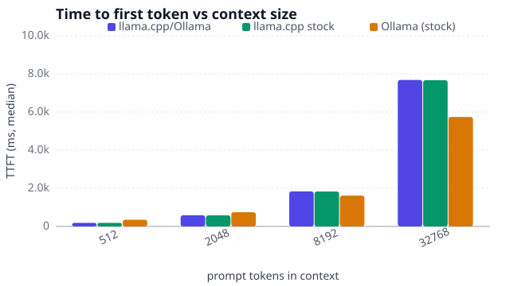
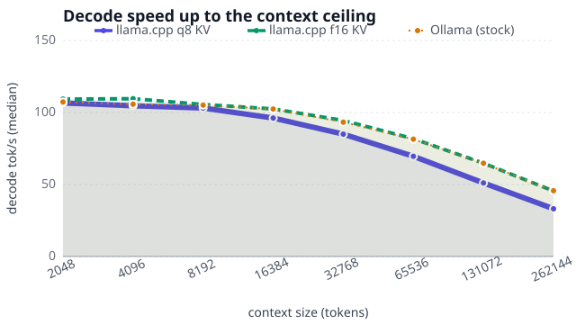
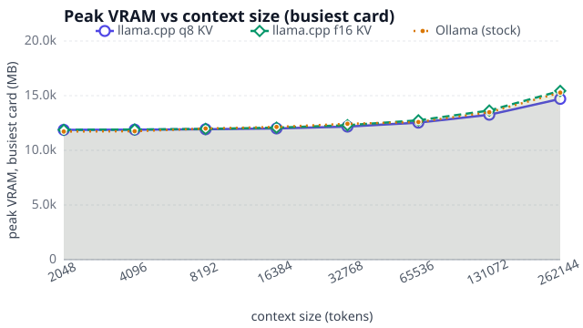
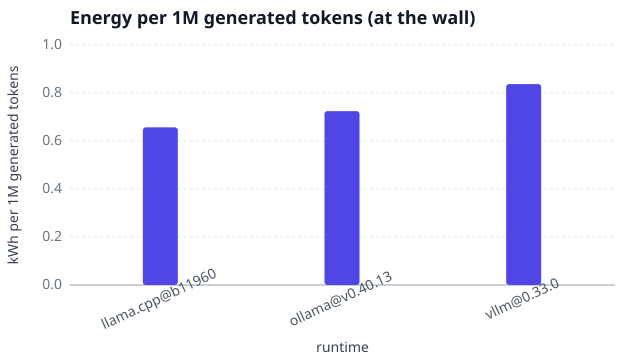
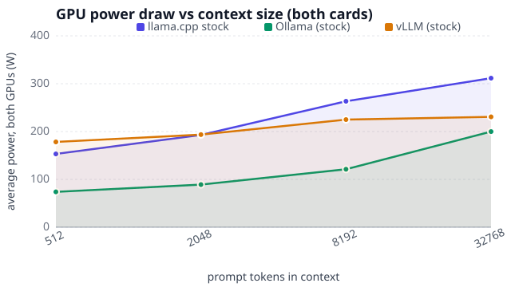
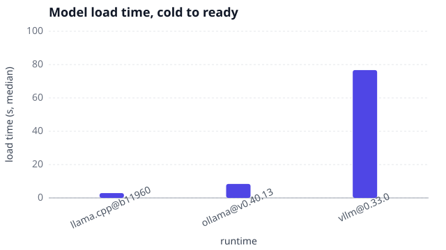
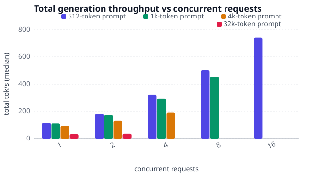
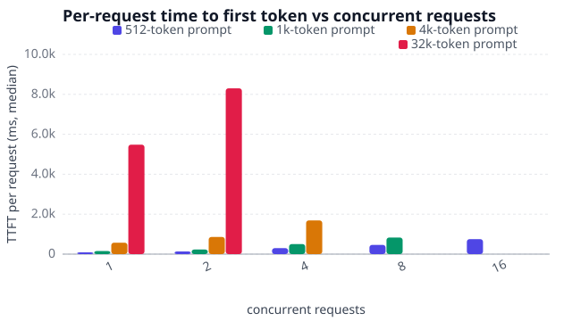

On two NVIDIA GeForce RTX 5060 Ti cards, qwen3.5-35b-a3b writes 110 tokens per second from a short prompt using stock llama.cpp. It can also hold a 260k-token context.

We ran qwen3.5-35b-a3b with three runtimes, llama.cpp, Ollama and vLLM, with no tuning, and measured generation speed, prompt processing, the wait for the first token, the context ceiling, memory, power at the wall socket and serving many users at once. This is the full-data companion to a shorter 5-minute article, and the exact test bench is described at the end.

For this model, the expected fit is more specialized work on systems with limited graphics memory.

## Straight to the Results

Every number below was measured on stock llama.cpp, and each row gets its own deep dive further down.

| Metric | 512 Context | 8k Context | 32k Context | Max Context (260k) |
| --- | --- | --- | --- | --- |
| Prompt Processing (tok/s) | 2734 | 4472 | 4274 | 2260 |
| TTFT | 187 ms | 1.8 s | 7.7 s | 116 s |
| Generation (tok/s) | 110 | 107 | 94 | 46 |

Energy at the wall: 0.66 kWh per 1M generated tokens, about 0.16 € at 0.25 €/kWh.

## The Verdict

qwen3.5-35b-a3b is a strong local option for an enthusiast computer with two NVIDIA GeForce RTX 5060 Ti cards.

- Speed: llama.cpp delivers the first token in **187 ms** at best, with generation falling from 110 tok/s to **46 tok/s** at the 260k-token context ceiling.
- Runtimes: on a short prompt, Ollama generates 108 tok/s with a 349 ms TTFT, versus 110 tok/s and 187 ms for llama.cpp; vLLM delivers its first token in **87 ms** and handles 16 concurrent requests at **740 tok/s** in total.
- Memory: the full 260k-token context peaks at **15434 MB** on the busiest card with the default f16 KV cache, compared with **14706 MB** using q8_0.
- Energy: wall energy per 1M generated tokens is **0.66 kWh** with llama.cpp, 0.72 kWh with Ollama, and **0.84 kWh** with vLLM.

## The Main Event: Generation Speed

How quickly does qwen3.5-35b-a3b write its answer once it starts, and does that pace change when you give it a longer prompt? The chart compares Ollama out of the box with llama.cpp in its stock configuration and with the exact flags Ollama passes, all using the exact same model file. Full configuration details are in the appendix at the end.

Stock llama.cpp decodes at **110** tok/s with a 512-token context versus 108 tok/s for stock Ollama, a modest 2.5 tok/s advantage. It slows to 107 tok/s at 8k tokens and **94** tok/s at 32k tokens, where Ollama achieves 93 tok/s and the gap narrows to 1.5 tok/s. Across that context range, llama.cpp loses 16 tok/s, or 14%, so context depth matters more than the runtime gap. With Ollama’s flags, llama.cpp still reaches 110 tok/s, matching stock llama.cpp rather than Ollama’s 108 tok/s and pointing to Ollama itself, not the flags.

## The Prefill Phase: Reading Speed

Before a model can write a response, it has to read your prompt, a step called prefill. How quickly it does this shapes how usable it feels with long inputs. The chart compares prefill speed across the same configurations as above.

Stock llama.cpp rises from 2734 tok/s at 512 tokens to a peak of **4472 tok/s** at 8k tokens. Prefill then declines modestly to 4274 tok/s at 32k tokens before falling to 2260 tok/s at the 260k-token maximum. Ollama starts lower at 1466 tok/s for 512 tokens but reaches its highest measured throughput of **5707 tok/s** at 32k tokens; no deeper Ollama measurements are provided to establish its eventual degradation.

## The Wait: Time to First Token

Time to first token, or TTFT, is the wait between hitting enter and seeing the first word appear. It helps explain why a model feels snappy or sluggish: the whole prompt has to be processed before the answer can begin, so longer prompts mean a longer wait.

Stock llama.cpp’s median TTFT rises from 187 ms at 512 tokens to 581 ms at 2k tokens and 1.8 s at 8k tokens. It reaches **7.7 s** at 32k tokens and 116 s at the 260k-token maximum. Ollama starts slower, taking 349 ms at 512 tokens, but finishes prefill sooner at 32k tokens with a TTFT of **5.7 s**. The gap is therefore prompt-dependent, not a fixed startup cost: the lead reverses between 512 and 32k tokens.

## Pushing Context to the Limit

Context is how much text a model can hold at once. We kept doubling it until the two graphics cards ran out of memory or the model reached its own limit. The chart shows how well generation speed holds up as context grows, comparing llama.cpp with its default memory cache, llama.cpp with a compressed cache, and Ollama.

Stock llama.cpp, the q8_0 KV-cache variant and Ollama all reach **260k tokens**; the `param_space.hi` stop reason indicates the model’s context ceiling, not an OOM. At that depth, stock llama.cpp decodes at **46 tok/s**, meaning generation proceeds at that rate once it starts, but the first token takes 116 s to arrive. The q8_0 cache lowers decode throughput from 46 tok/s to 33 tok/s and raises TTFT to 119 s, without extending the measured context ceiling beyond 260k tokens.

## The Memory Wall

Each graphics card has its own fixed pool of memory, and the model and its context are spread across both cards. Every extra token of context uses a little more memory: this chart tracks that growth on the busiest card and shows how compressing the KV cache, which stores information from earlier tokens, leaves more room to work.

Each card has 16311 MB of VRAM; these measurements describe the busiest card, not combined memory. Stock llama.cpp rises from 11876 MB at 512 tokens to 15434 MB at its 260k-token ceiling, a net increase of 3558 MB, although these endpoints do not establish the curve’s shape. The q8_0 KV cache peaks lower at 14706 MB at 260k tokens, but without its starting measurement, its slope cannot be quantified. At that ceiling, q8_0 saves **728 MB**, increasing headroom on the busiest card from 877 MB to **1605 MB**.

## Energy & What It Costs

Every token generated uses electricity, so we measured that use at the wall socket with a smart plug, capturing the whole computer rather than just the graphics cards. The chart compares how many kilowatt-hours each runtime uses to generate a million tokens.

Stock llama.cpp uses **0.66** kWh per 1M generated tokens at the wall, compared with 0.72 kWh for Ollama and **0.84** kWh for vLLM. Average wall draw during the llama.cpp run with an 8k-token prompt is 373 W. Its energy breakdown per 1M generated tokens is 0.42 kWh across both GPUs, 0.051 kWh for the CPU package and 0.19 kWh for the rest of the box, including power supply losses, RAM, fans and drives. At 0.25 €/kWh, llama.cpp costs about 0.16 € per 1M generated tokens.

## How Hard the GPU Works

Each graphics card has a stock power limit of 150 W, so together they can draw up to 300 W. How close a runtime gets to that limit tells you how hard it makes the cards work, which drives heat, fan noise and the power bill. The chart shows the average power draw of both cards combined as the prompt grows, for each runtime.

From the shortest to the longest prompt, combined average GPU draw rises from 153 W to **312 W** for llama.cpp, from 74 W to 200 W for Ollama, and from 178 W to 231 W for vLLM, against the pair’s **300 W** limit. vLLM draws the most at the shortest prompt at 178 W, but llama.cpp works the cards hardest at the longest, exceeding the limit at 312 W; neither Ollama at 200 W nor vLLM at 231 W gets close.

## Cold Start: From Disk to First Word

Before it can give its first answer, the model has to be loaded from disk into the two graphics cards: this is the cold start. That wait matters for services that unload the model when idle, because they must load it again when a new request arrives. The chart compares how long each runtime takes to get ready.

Cold-start loading takes 2.9 s with stock llama.cpp, 8.4 s with Ollama and **77 s** with vLLM. Once loaded, TTFT for a 512-token prompt is 187 ms on llama.cpp, 349 ms on Ollama and **87 ms** on vLLM. For this measured workload, llama.cpp’s 2.9 s load favors on-demand serving, while vLLM’s 87 ms warm TTFT favors keeping the model loaded.

## Serving Many Users at Once: vLLM

Everything so far measured one request at a time, but a model serving a team or an application has to handle many requests at once. That is the job of vLLM, a server runtime used in production deployments: it interleaves requests through the GPUs rather than making each wait its turn, a technique called continuous batching, and here it splits the model evenly across both cards. One caveat: vLLM uses a different compressed model file (awq-AWQ-4bit) from llama.cpp and Ollama (gguf-Q4_K_M), so this compares complete setups, not just programs.

On a single request, vLLM leads stock llama.cpp in prefill at 512 tokens: 5875 tok/s versus 2734 tok/s, with TTFT of **87 ms** versus **187 ms**. At 32k tokens, vLLM retains the TTFT lead at 5.5 s versus 7.7 s. vLLM also leads decode at both prompt lengths: 117 versus 110 tok/s at 512 tokens and 108 versus 94 tok/s at 32k tokens. The operational costs are a cold start of **77 s** versus **2.9 s**, plus vLLM’s up-front pre-allocation of up to **14641 MB** per card out of **16311 MB**, regardless of prompt length.

Stock vLLM reached **66k tokens** of context, compared with **260k tokens** for stock llama.cpp on the same two cards. A `runtime_crash` probe outcome means the server failed to start at the tested context size; it does not establish why.

At 512-token prompts, increasing concurrency from 1 to 16 requests raises total generation throughput from **113** to **740** tok/s, while per-stream decode throughput falls from 117 to 54 tok/s. Gains persist over the measured ranges at longer prompts: 1024-token prompts rise from 109 to 453 tok/s at concurrency 1 to 8, while 4096-token prompts rise from 92 to 191 tok/s at concurrency 1 to 4. At 33k-token prompts, the gain is much smaller: throughput increases from 32 to 36 tok/s when concurrency rises from 1 to 2 requests. For 512-token prompts, wall draw increases from 255 to 313 W while throughput rises from 113 to 740 tok/s, reducing energy cost per generated token under load.

For 512-token prompts, median TTFT rises from **89 ms** alone to **750 ms** at 16 concurrent requests, a noticeable pause before the response starts. Longer prompts increase that wait: with 1024 tokens, TTFT rises from 154 ms alone to 831 ms at 8 concurrent requests; with 4096 tokens, it rises from 573 ms to 1.7 s at 4 concurrent requests. The 33k-token line already starts at 5.5 s alone and reaches 8.3 s with 2 concurrent requests, making first-token latency a multi-second wait even under light concurrency.

## Appendix: Test Bench & Method

The hardware stays the same throughout the series so results remain comparable between models. Every runtime runs exactly as installed, with no tuning. Power is measured at the wall socket with a smart plug, covering the whole box rather than just the GPUs. llama.cpp and Ollama decide for themselves how to spread the model over the two cards, while vLLM splits it evenly across both using tensor parallelism.

| Component | Specification |
|---|---|
| cpu | Intel Core Ultra 7 265K |
| motherboard | ASUS ROG MAXIMUS Z890 APEX Hovedkort - Intel Z890 |
| ram | Kingston FURY Beast DDR5-5600 - 64GB |
| gpu | 2 × MSI GeForce RTX 5060 Ti (16 Gb GDDR7 each, 32 Gb in total) |
| system | Linux 7.0.0-38-generic |
| nvidia driver | 615.71.09 |
| llama.cpp version | llama.cpp@b11960 |
| ollama version | ollama@v0.40.13 |
| vllm version | vllm@0.33.0 |
| model artifact (llama.cpp, Ollama) | gguf-Q4_K_M |
| model artifact (vLLM) | awq-AWQ-4bit |

## Appendix: The Contenders

We ran the same model in several setups: Ollama as installed, stock llama.cpp, and llama.cpp with the exact flags Ollama passes. We also tested llama.cpp with a compressed q8_0 KV cache to make room for longer inputs, plus vLLM spread across both graphics cards, with and without its fp8 KV-cache option. The table below lists every configuration and the flags it changes; “stock” means each runtime’s own defaults.

| Role | Runtime | Flags |
| --- | --- | --- |
| best:kv_type=q8_0 | `llama.cpp@b11960` | `-fa on -ctk q8_0 -ctv q8_0` |
| reference:ollama-defaults | `llama.cpp@b11960` | `-fa auto -ctk f16 -ctv f16 -b 512 -ub 512 -t 4` |
| baseline | `llama.cpp@b11960` | stock |
| defaults | `ollama@v0.40.13` | stock |
| baseline | `vllm@0.33.0` | `--tensor-parallel-size 2` |

## Further Reading

For a quick overview, read the [short 5-minute article about this model](MODEL-SHORT-ARTICLE-URL).
