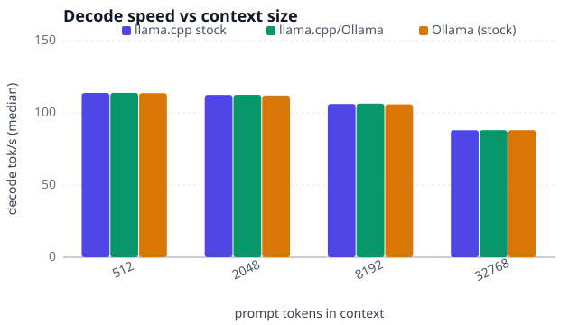
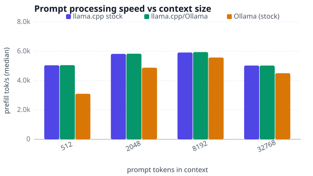
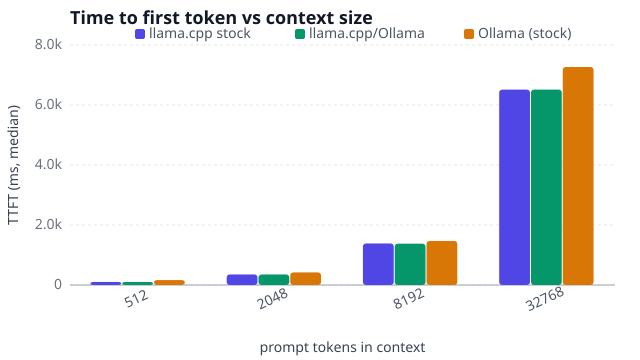
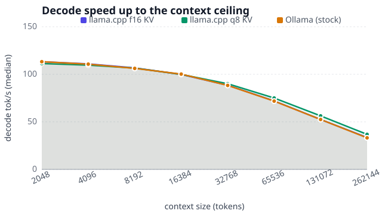
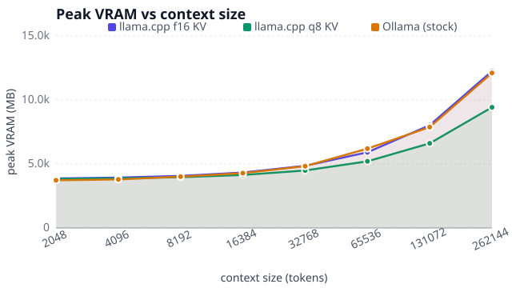
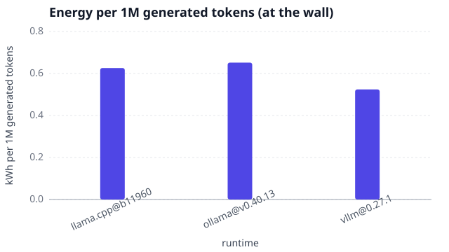
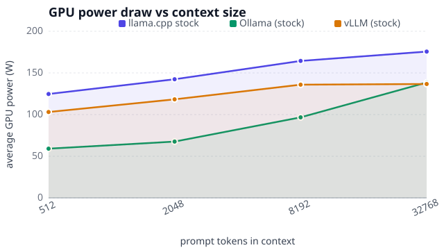
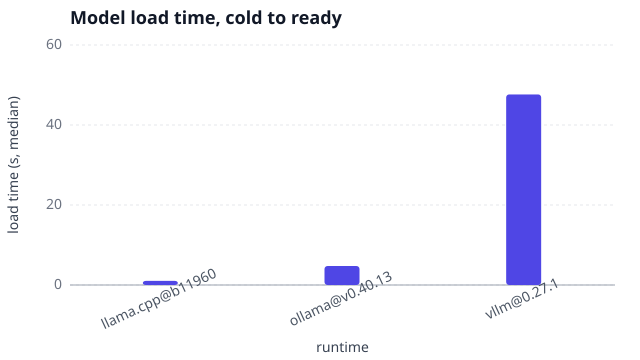
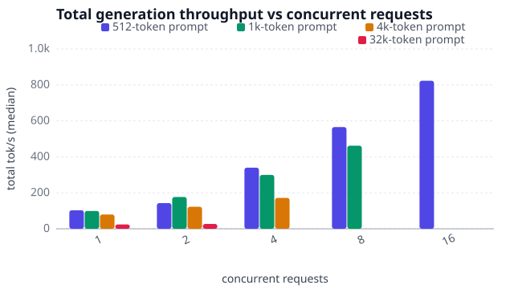
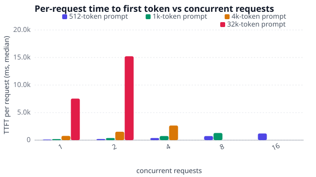

Qwen3.5-4b writes 114 tokens per second on a short prompt with stock llama.cpp on an NVIDIA GeForce RTX 5060 Ti. It also holds a 260k-token context in 12 GB of the card’s 16 GB of memory.

We ran qwen3.5-4b with three runtimes, llama.cpp, Ollama and vLLM, each exactly as it installs and with no tuning, and measured generation speed, prompt processing, the wait for the first token, the context ceiling, memory use, power at the wall socket and how it serves many users at once. At 4B, it sits in the small-model category, which can be interesting for mobile or edge devices. This is the full-data companion to the shorter 5-minute article, and the exact test bench is described at the end.

## Straight to the Results

Every number below was measured on stock llama.cpp, and each row gets its own deep dive further down.

| Metric | 512 Context | 8k Context | 32k Context | Max Context (262144) |
| --- | --- | --- | --- | --- |
| Prompt Processing (tok/s) | 5050 | 5921 | 5031 | 1946 |
| TTFT | 101 ms | 1.4 s | 6.5 s | 135 s |
| Generation (tok/s) | 114 | 106 | 88 | 34 |

Energy: 0.63 kWh per 1M generated tokens at the wall, about 0.16 € at 0.25 €/kWh.

## The Verdict

Qwen3.5-4b is a practical fit for a budget computer with an NVIDIA GeForce RTX 5060 Ti, provided you accept slower generation and higher memory use at the full context.

- Speed: the first token arrives in 101 ms at best, while generation falls from 114 tok/s to **34 tok/s** at the 260k-token ceiling.
- Runtimes: on a short prompt, Ollama generates 114 tok/s with a 165 ms TTFT, versus 114 tok/s and 101 ms for llama.cpp; vLLM returns its first token in 101 ms and serves 16 concurrent requests at **823 tok/s** in total.
- Memory: the full 260k-token context peaks at **12 GB** with the default f16 KV cache, compared with 9.4 GB using a q8_0 KV cache.
- Energy: at the wall, energy use per 1M generated tokens is 0.63 kWh with llama.cpp, 0.65 kWh with Ollama, and **0.52 kWh** with vLLM.

## The Main Event: Generation Speed

This section looks at how quickly qwen3.5-4b writes its answers, and how that pace changes as the prompt gets longer. The chart compares Ollama out of the box with stock llama.cpp and with llama.cpp using the exact flags Ollama passes, all running the exact same model file. Full configuration details are in the appendix at the end.

Stock median decode throughput is effectively a tie: llama.cpp leads Ollama by only 0.14 tok/s at 512 tokens, while Ollama leads by 0.043 tok/s at 32k tokens. Context depth is what costs speed: llama.cpp falls from **114 tok/s** at 512 tokens to 106 tok/s at 8k and **88 tok/s** at 32k, a 23% loss. Ollama follows essentially the same curve, also losing 23% by 32k, so context depth rather than runtime choice drives the slowdown. With Ollama’s own flags, llama.cpp lands on stock llama.cpp: its 512-token result is only 0.035 tok/s higher, versus 0.17 tok/s above stock Ollama, so those flags do not explain Ollama’s slight deficit.

## The Prefill Phase: Reading Speed

Before a model writes anything, it first has to read your prompt, a step called prefill. On long inputs, this reading speed shapes how responsive and practical the model feels, so this chart compares prefill performance for the same configurations as above.

Stock llama.cpp climbs from 5050 tok/s at 512 tokens to an 8k-token peak of **5921 tok/s**, then falls to 5031 tok/s at 32k and **1946 tok/s** at the 260k-token maximum, a 67% drop from peak. Ollama starts at 3107 tok/s at 512 tokens and also peaks at 8k, reaching 5578 tok/s, before declining to 4509 tok/s at 32k. Its 19% peak-to-32k decline is steeper than llama.cpp’s 15%, with 7.3 s TTFT versus 6.5 s at 32k; no Ollama measurement is provided at 260k tokens.

## The Wait: Time to First Token

TTFT, short for time to first token, is the wait between pressing Enter and seeing the first word appear, and it plays a big part in whether a model feels snappy or sluggish. Longer prompts usually mean a longer wait, because the model must process the entire prompt before it can start answering.

Stock llama.cpp’s median TTFT rises from 101 ms at 512 tokens to 351 ms at 2k, 1.4 s at 8k and 6.5 s at 32k, before reaching **135 s** at the 260k-token maximum. Ollama is slower at 165 ms versus 101 ms for 512 tokens, and 7.3 s versus 6.5 s at 32k. The absolute gap therefore does not stay a fixed cost: it grows from 63 ms to **0.75 s**, although Ollama’s relative TTFT penalty shrinks from 63% to 12%.

## Pushing Context to the Limit

Context is how much text a model can hold at once, so a larger context leaves room for longer prompts and conversations. We kept doubling it until the card ran out of memory or the model hit its own ceiling, and the chart shows how generation speed holds up for llama.cpp with its default KV cache, llama.cpp with a compressed q8_0 KV cache, and Ollama.

Stock llama.cpp and the q8_0 KV cache both reach 260k tokens and stop with `param_space.hi`, so the probe hit the model’s context ceiling rather than an OOM; Ollama also reaches 260k tokens. At that depth, stock llama.cpp decodes at **34 tok/s**, but its 134.5 s TTFT means a full-context request has a substantial initial wait before generation continues at that rate. The q8_0 cache decodes at **37 tok/s** with a 144.2 s TTFT, so it does not cost decode throughput here: it gains 3.3 tok/s while adding 9.6 s to TTFT and preserving the same context ceiling.

## The Memory Wall

Your graphics card has a fixed amount of memory, and every extra token of context uses a little more of it. This chart shows how that memory demand grows, and how compressing the KV cache, the model’s working memory for the conversation, buys back headroom for longer contexts.

Stock llama.cpp climbs steeply from 3873 MB at 512 tokens to **12253 MB** at its 260k-token ceiling, adding 8380 MB over the measured range. The q8_0 KV-cache curve is shallower, peaking at **9430 MB** at the same 260k tokens, or 2823 MB below stock. On the 16311 MB card, q8_0 therefore leaves 6881 MB of headroom versus 4058 MB for stock, buying an extra 2823 MB before the VRAM limit is reached.

## Energy & What It Costs

Every token generated costs electricity, so we measured it at the wall socket with a smart plug, capturing the whole computer rather than just the graphics card. The chart compares how many kilowatt-hours each runtime uses to generate a million tokens, showing the energy cost of the same workload across runtimes.

At the wall, stock llama.cpp consumes **0.63 kWh** per 1M generated tokens, marginally below Ollama at 0.65 kWh per 1M tokens but above vLLM at **0.52 kWh** per 1M tokens, while averaging 264 W during the 8k-prompt llama.cpp run. The llama.cpp total splits into 0.38 kWh per 1M tokens on the GPU, 0.047 kWh per 1M tokens on the CPU package and 0.20 kWh per 1M tokens for the rest of the box, including power-supply losses, RAM, fans and drives. At 0.25 €/kWh, that llama.cpp wall energy costs about 0.16 € per 1M generated tokens.

## Cold Start: From Disk to First Word

Before a model can generate its first response, the runtime has to load it from disk into the graphics card’s memory, a step known as a cold start. For services that unload models when they sit idle, this delay affects how quickly the next request can be answered. The chart compares how long each runtime takes to become ready.

Cold-start loading takes 1.0 s on stock llama.cpp and 4.7 s on Ollama, versus **48 s** on vLLM, making vLLM’s model load its dominant cold-start cost. Once loaded, TTFT after the 512-token prompt rounds to **101 ms** on both llama.cpp and vLLM, compared with 165 ms on Ollama. For on-demand serving, llama.cpp has the lowest startup penalty among these engines, while keeping the model warm avoids vLLM’s loading delay and leaves its first-token latency nearly level with llama.cpp.

## Serving Many Users at Once: vLLM

Everything so far has measured one request at a time, but a model serving a team or an application must handle many requests at once. That is the job of vLLM, a server runtime used in production deployments: it interleaves requests through the GPU instead of making them wait in a queue, a technique called continuous batching. One caveat: vLLM runs a different compressed model file (awq-AWQ-4bit) from the one used by llama.cpp and Ollama (gguf-Q4_K_M), so this compares two complete setups, not just two programs.

Stock llama.cpp narrowly leads prefill at 512 tokens, with 5050 tok/s versus vLLM’s 5047 tok/s and a 101 ms TTFT for both, and it stays ahead at 32k with a TTFT of 6.5 s versus 7.5 s. It also leads decode at both sizes: 114 tok/s versus 107 tok/s at 512 tokens and 88 tok/s versus 86 tok/s at 32k, so vLLM leads neither phase. The operational costs also favor llama.cpp: vLLM’s cold start takes **48 s** versus 1027 ms, and vLLM pre-allocates **14932 MB** of the card’s 16311 MB up front whatever the prompt length.

vLLM’s stock configuration reached a maximum context of **256k tokens**, with its first OOM at 258k tokens, versus **262k tokens** for stock llama.cpp on the same card. A `runtime_crash` outcome means the server failed to start at that context size; it does not identify the underlying cause.

At 512-token prompts, total generation throughput climbs from 103 tok/s at one request to **823 tok/s** at 16 concurrent requests, an 8.0× gain, while median per-stream decode throughput falls from 107 tok/s to 69 tok/s. Longer prompts retain less of that scaling: 1024-token prompts rise from 99 tok/s to 462 tok/s at eight requests (4.7×), and 4096-token prompts from 80 tok/s to 172 tok/s at four requests (2.2×). With 32768-token prompts, the gain is just 1.1×, with throughput increasing only from 24 tok/s to **27 tok/s** at two requests. For the 512-token series, wall draw rises from 131 W to 200 W, far less than throughput, so the energy cost of each token falls under load.

At 512-token prompts, median TTFT rises from **106 ms** alone to **1.2 s** at 16 concurrent requests: the solo wait is unlikely to be noticed, whereas the loaded wait is a clear pause. Longer prompts shift the curves upward and make latency noticeable at lower concurrency: 1024 tokens reach 1.3 s at eight requests, 4096 tokens rise from 770 ms alone to 2.7 s at four, and 32768 tokens rise from 7.5 s alone to 15.2 s at two, consistent with prefill dominating TTFT.

## Appendix: Test Bench & Method

The hardware never changes across the whole series, so results stay comparable between models. Every runtime runs exactly as it installs, with no tuning. Power is measured at the wall socket with a smart plug, covering the whole box, not just the GPU.

| Component | Specification |
|---|---|
| cpu | Intel Core Ultra 7 265K |
| motherboard | ASUS ROG MAXIMUS Z890 APEX Hovedkort - Intel Z890 |
| ram | Kingston FURY Beast DDR5-5600 - 64GB (32 Gb) |
| gpu | MSI GeForce RTX 5060 Ti (16 Gb GDDR7) |
| system | Linux 7.0.0-38-generic |
| nvidia driver | 615.71.09 |
| llama.cpp version | llama.cpp@b11960 |
| ollama version | ollama@v0.40.13 |
| vllm version | vllm@0.27.1 |
| model artifact (llama.cpp, Ollama) | gguf-Q4_K_M |
| model artifact (vLLM) | awq-AWQ-4bit |

## Appendix: The Contenders

I ran the same model under several configurations to separate the impact of the software that runs it from the impact of individual settings. Alongside Ollama exactly as it installs, stock llama.cpp, and stock vLLM, the comparison includes llama.cpp with Ollama’s exact flags, plus variants that compress the KV cache, the memory used to track the current context: q8_0 in llama.cpp to fit a longer context, and fp8 in vLLM. The table below lists every configuration and the knobs that differ; empty cells mean the runtime’s default was left unchanged.

| Role | Runtime | Flags |
| --- | --- | --- |
| baseline | `llama.cpp@b11960` | stock |
| reference:ollama-defaults | `llama.cpp@b11960` | `-fa auto -ctk f16 -ctv f16 -b 512 -ub 512 -t 4` |
| best:kv_type=q8_0 | `llama.cpp@b11960` | `-fa on -ctk q8_0 -ctv q8_0` |
| defaults | `ollama@v0.40.13` | stock |
| baseline | `vllm@0.27.1` | stock |

## Further Reading

[Read the short 5-minute article about this model](PLACEHOLDER_URL)

[Read the previous article in the series](PLACEHOLDER_URL)

[Read the next article in the series](PLACEHOLDER_URL)
