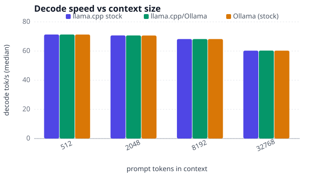
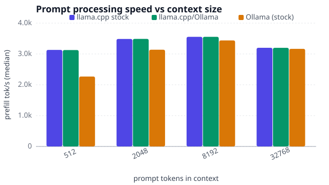
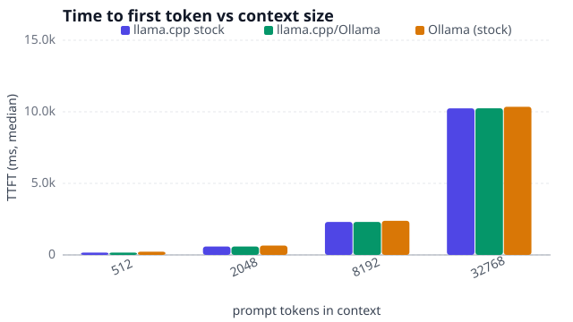
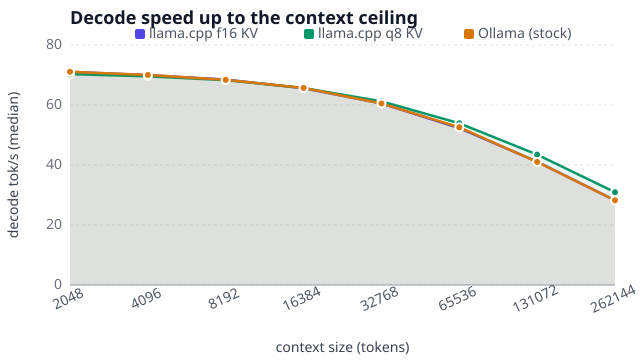
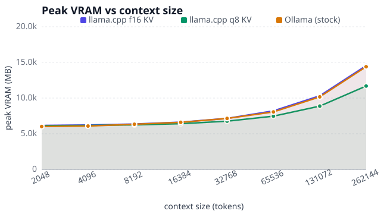
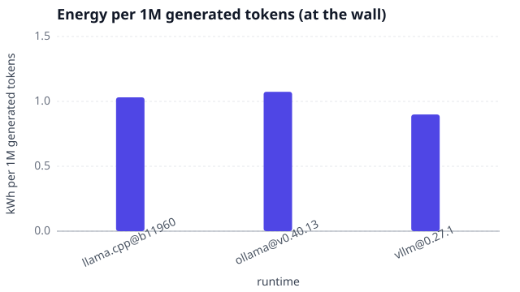
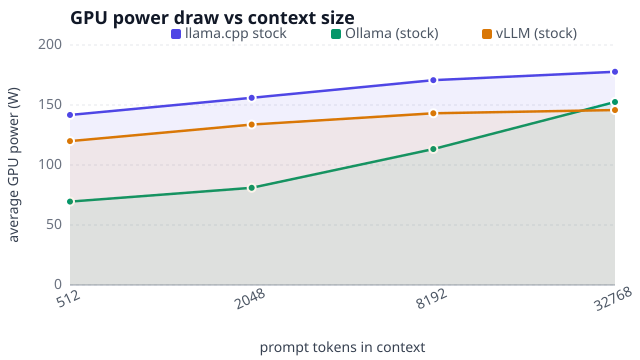
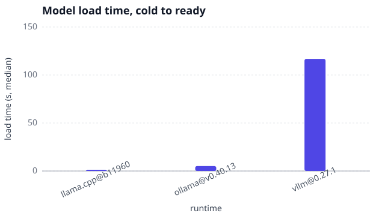
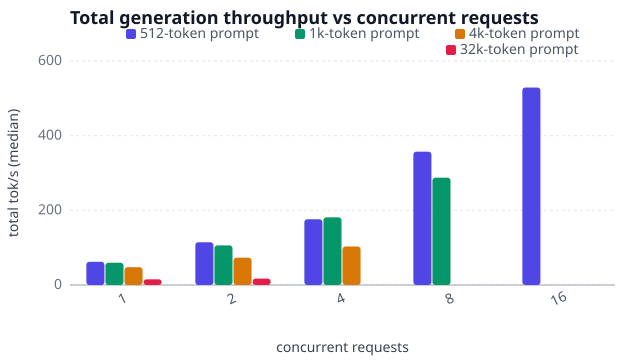
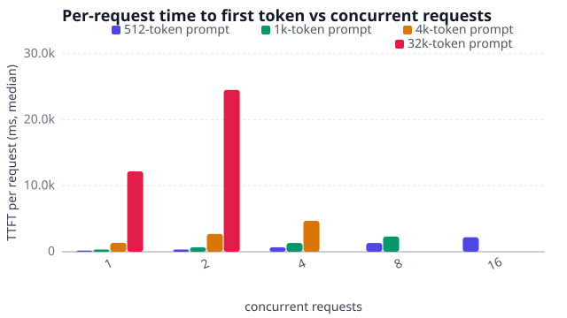

On an NVIDIA GeForce RTX 5060 Ti, qwen3.5-9b writes 71 tokens per second from a short prompt using stock llama.cpp. It also fits a 260k-token context into 15 GB of the card’s 16 GB of memory.

We ran qwen3.5-9b with three runtimes, llama.cpp, Ollama and vLLM, without tuning any of them. We measured generation speed, prompt processing, the wait for the first token, the context ceiling, memory use, power at the wall socket and performance when serving many users at once. This is the full-data companion to our shorter 5-minute article, with the exact test bench described at the end.

At this size, expect a step beyond models built mainly for speed or edge devices, but not the analytical depth of larger models.

## Straight to the Results

Every number below was measured on stock llama.cpp, and each row gets its own deep dive further down.

| Metric                    | 512 Context | 8k Context | 32k Context | Max Context (260k) |
| ------------------------- | ----------- | ---------- | ----------- | ------------------ |
| Prompt Processing (tok/s) | 3131        | 3555       | 3200        | 1588               |
| TTFT                      | 164 ms      | 2.3 s      | 10 s        | 2.7 min            |
| Generation (tok/s)        | 71          | 68         | 60          | 28                 |

Energy use at the wall was 1.0 kWh per 1M generated tokens, costing about 0.25 € at 0.25 €/kWh.

## The Verdict

qwen3.5-9b is a practical choice for a budget computer with an NVIDIA GeForce RTX 5060 Ti, though generation slows at its longest context.

- Speed: The first token arrives in **164 ms** at best; generation falls from 71 tok/s to **28 tok/s** at the 260k-token ceiling.
- Runtimes: On a short prompt, Ollama and llama.cpp both generate 71 tok/s, with TTFTs of 226 ms and 164 ms respectively. vLLM delivers its first token in 179 ms and handles 16 simultaneous requests at **529 tok/s** total.
- Memory: At the full 260k-token context, peak memory reaches **15 GB** with the default f16 KV cache, versus **12 GB** with q8_0.
- Energy: Wall-measured consumption per 1M generated tokens is 1.0 kWh with llama.cpp, 1.1 kWh with Ollama, and **0.90 kWh** with vLLM.

## The Main Event: Generation Speed

How quickly qwen3.5-9b writes its answer can change as the prompt gets longer. The chart compares Ollama out of the box with llama.cpp in its stock configuration and with the exact flags Ollama passes, all using the exact same model file. Full configuration details are in the appendix at the end.

At 512 tokens, stock llama.cpp and Ollama both decode at **71** tok/s after rounding, separated by just 0.015 tok/s. At 32k tokens, both reach **60** tok/s, with Ollama ahead by only 0.0050 tok/s. Stock llama.cpp falls to 68 tok/s at 8k tokens, losing 11 tok/s overall between 512 and 32k tokens, a 16% decline. With Ollama’s flags, llama.cpp lands closer to stock llama.cpp, just 0.0040 tok/s away versus 0.019 tok/s from Ollama, pointing to the runtime rather than the flags as the source of this negligible separation.

## The Prefill Phase: Reading Speed

Before a model can write a response, it must first read the prompt, a step called prefill. How quickly it does this shapes how usable it feels with long inputs. The chart compares the same configurations as above to show how they handle this initial reading step.

At 512 tokens, stock llama.cpp delivers 3131 tok/s versus Ollama’s 2268 tok/s; both peak at 8k tokens, reaching **3555** tok/s and 3439 tok/s respectively. Prefill degradation remains modest at 32k tokens, where llama.cpp sustains 3200 tok/s and Ollama 3165 tok/s. Stock llama.cpp falls further to **1588** tok/s at its 260k-token maximum; the supplied Ollama measurements stop at 32k tokens.

## The Wait: Time to First Token

Time to first token, or TTFT, is the wait between hitting enter and seeing the first word appear. It shapes whether a model feels snappy or sluggish, and it grows with the prompt because the model must process the whole prompt before it can start answering.

Stock llama.cpp’s median TTFT rises from 164 ms at 512 tokens to 587 ms at 2k tokens, 2.3 s at 8k tokens, and 10 s at 32k tokens. At the maximum tested prompt of 260k tokens, TTFT reaches 2.7 min. Ollama takes 226 ms at 512 tokens and 10 s at 32k tokens, with the latter rounded value masking a small difference. Its absolute gap over stock llama.cpp grows from **62 ms** to **111 ms** across those endpoints, so the overhead is not strictly fixed, although it remains small relative to long-prompt TTFT.

## Pushing Context to the Limit

A model’s context is the amount of text it can hold at once. We kept doubling that amount until the graphics card ran out of memory or the model reached its own limit. The chart shows how generation speed holds up along the way, comparing llama.cpp with its default memory cache, llama.cpp with a compressed cache, and Ollama.

Stock llama.cpp, its q8_0 KV-cache variant, and Ollama all reach **260k tokens**; the `param_space.hi` stop reason identifies the model’s context ceiling, not an OOM limit. At that depth, stock llama.cpp takes **165 s** to produce its first token, then decodes at 28 tok/s: generation continues at that rate once the initial wait is over. The q8_0 cache shows no decode-speed penalty, delivering 31 tok/s versus stock’s 28 tok/s, but increases TTFT to 174 s versus 165 s.

## The Memory Wall

A graphics card has a fixed amount of memory, and each extra token of context uses a little more of it. This chart shows how that memory use grows, and how compressing the KV cache, which stores information from earlier tokens, leaves room for more context.

Stock llama.cpp climbs from 6166 MB at 512 tokens to 14546 MB at its 260k-token ceiling, averaging 32 MB of additional VRAM per 1k context tokens. The q8_0 KV cache peaks at **11690 MB** at the same ceiling, although its slope cannot be established without a lower-context measurement. Against the card’s 16311 MB capacity, q8_0 leaves 4621 MB free versus 1765 MB for stock, buying **2856 MB** of additional headroom without increasing the measured context ceiling.

## Energy & What It Costs

Every token an AI model generates uses electricity. We measured that electricity at the wall socket with a smart plug, capturing the whole computer’s consumption, not just the graphics card’s. The chart compares how much energy each runtime uses to generate the same amount of text.

Stock llama.cpp consumes **1.0** kWh per 1M generated tokens at the wall, compared with 1.1 kWh for Ollama and **0.90** kWh for vLLM. During the llama.cpp run with an 8k-token prompt, average wall draw is 270 W. The llama.cpp energy breakdown is 0.63 kWh for the GPU, 0.076 kWh for the CPU package and 0.32 kWh for the rest of the system, including power supply losses, RAM, fans and drives, all per 1M generated tokens. At 0.25 €/kWh, llama.cpp costs about 0.26 € per 1M generated tokens.

## How Hard the GPU Works

The graphics card has a stock power limit of 160 W: the closer a runtime gets to that limit, the harder it makes the card work, affecting heat, fan noise and the power bill. The chart shows how the card’s average power draw changes as the prompt grows, for each runtime.

At the shortest and longest prompts, llama.cpp averages 142 W and **178 W**, respectively, drawing the most power and exceeding the stated 160 W limit at the longest prompt. Ollama rises from 70 W to **153 W**, approaching the 160 W limit, while vLLM rises from 120 W to 146 W and stays below it.

## Cold Start: From Disk to First Word

Before a model can give its first answer, it has to load from disk into the graphics card, a step called a cold start. Services that unload the model when idle must repeat this step before answering a new request. The chart compares how long each runtime takes to get ready.

Stock llama.cpp loads in **1.3 s**, compared with 5.1 s for Ollama and **117 s** for vLLM. Once loaded, TTFT after a 512-token prompt is 164 ms on llama.cpp, 226 ms on Ollama and 179 ms on vLLM. On-demand serving must absorb the loading delay, whereas keeping the model warm avoids that stage and leaves a measured TTFT of 164–226 ms for this prompt.

## Serving Many Users at Once: vLLM

Everything so far measured one request at a time, but a model serving a team or an application receives many requests at once. That is the job of vLLM, a server runtime used in production deployments: it interleaves requests through the GPU instead of making each wait its turn, a technique called continuous batching. One caveat: vLLM uses a different compressed model file (awq-AWQ-4bit) from llama.cpp and Ollama (gguf-Q4_K_M), so this compares two complete setups, not just two programs.

On a single request, stock llama.cpp leads vLLM in prefill at 512 tokens: 3131 versus 2862 tok/s, yielding TTFTs of 164 versus 179 ms. At 32k tokens, llama.cpp retains the prefill lead, with a TTFT of 10 s versus vLLM’s 12 s. llama.cpp also leads decode at both prompt lengths: 71 versus 65 tok/s at 512 tokens and 60 versus 56 tok/s at 32k tokens. Operationally, vLLM takes **117 s** to cold-start versus **1.3 s** for llama.cpp, and pre-allocates **14536 MB** of the card’s **16311 MB** up front regardless of prompt length.

On the same card, stock vLLM reached **66k tokens**, compared with **260k tokens** for stock llama.cpp. A `runtime_crash` probe outcome means the server failed to start at the tested context size, without establishing why.

At 512-token prompts, increasing concurrency from 1 to 16 requests raises total generation throughput from **62 tok/s** to **529 tok/s**, while per-stream decode falls from 65 tok/s to 46 tok/s. Batching gains diminish with longer prompts: throughput rises from 60 to 288 tok/s at 1024 tokens across 1 to 8 concurrent requests, and from 48 to 103 tok/s at 4096 tokens across 1 to 4 requests. At 33k-token prompts, increasing concurrency from 1 to 2 requests yields only 15 to 17 tok/s, leaving little aggregate throughput gain. Across the 512-token sweep, wall draw increases from 171 W to 209 W while throughput climbs from 62 tok/s to 529 tok/s, reducing energy cost per generated token under load.

For 512-token prompts, median TTFT rises from **180 ms** with one request to **2.2 s** at 16 concurrent requests, a delay users would notice before output begins. Longer prompts make the wait more pronounced: at 1024 tokens, median TTFT grows from 340 ms to 2.3 s at eight concurrent requests; at 4096 tokens, it rises from 1.3 s to 4.7 s at four concurrent requests. For 33k-token prompts, even a single request takes 12 s to produce its first token, increasing to 25 s with two concurrent requests.

## Appendix: Test Bench & Method

The hardware stays the same throughout the series so results remain comparable between models. Every runtime runs exactly as installed, with no tuning. A smart plug measures power at the wall socket for the whole system, not just the GPU.

| Component | Specification |
|---|---|
| cpu | Intel Core Ultra 7 265K |
| motherboard | ASUS ROG MAXIMUS Z890 APEX Hovedkort - Intel Z890 |
| ram | Kingston FURY Beast DDR5-5600 - 64GB (32 Gb) |
| gpu | MSI GeForce RTX 5060 Ti (16 Gb GDDR7) |
| system | Linux 7.0.0-38-generic |
| nvidia driver | 615.71.09 |
| llama.cpp version | llama.cpp@b11960 |
| ollama version | ollama@v0.40.13 |
| vllm version | vllm@0.27.1 |
| model artifact (llama.cpp, Ollama) | gguf-Q4_K_M |
| model artifact (vLLM) | awq-AWQ-4bit |

## Appendix: The Contenders

We ran the same model in several setups: Ollama exactly as installed, stock llama.cpp, llama.cpp with the exact flags Ollama passes, and llama.cpp with a compressed q8_0 KV cache to make room for longer inputs. We also tested stock vLLM and its fp8 KV-cache variant. The table below lists every configuration and the flags it changes; “stock” means each runtime’s own defaults.

| Role | Runtime | Flags |
| --- | --- | --- |
| baseline | `llama.cpp@b11960` | stock |
| reference:ollama-defaults | `llama.cpp@b11960` | `-fa auto -ctk f16 -ctv f16 -b 512 -ub 512 -t 4` |
| best:kv_type=q8_0 | `llama.cpp@b11960` | `-fa on -ctk q8_0 -ctv q8_0` |
| defaults | `ollama@v0.40.13` | stock |
|  | `vllm@0.27.1` | stock |
| baseline | `vllm@0.27.1` | stock |

## Further Reading

-
