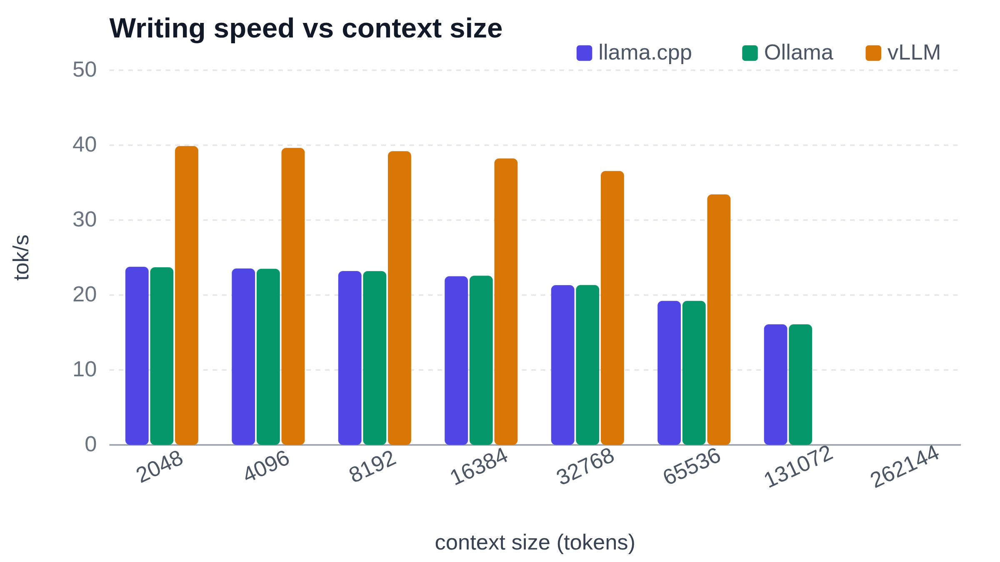
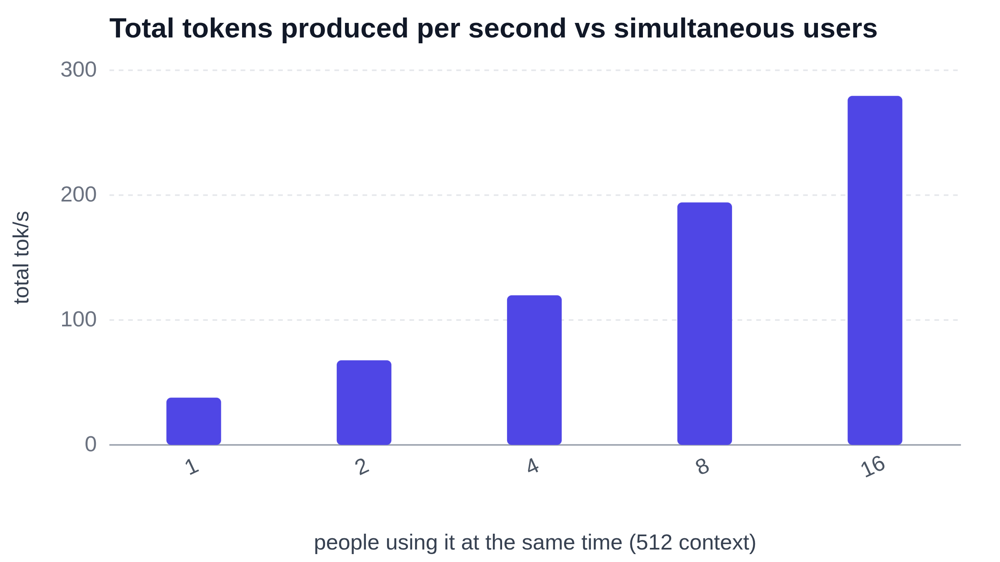

qwen3.5-27b holds **230k** tokens of context and writes **24** tokens per second on a short prompt. Hand it a 100-page book and it starts answering after **20** s, then writes **4.5** times faster than you can read. It is a dense AI model with 27 billion parameters, a size that starts to be useful for analysis and general knowledge. Here, it runs on a computer with **two** NVIDIA GeForce RTX 5060 Ti cards working together.

## Straight to the Results

Qwen3.5-27b is usable on a computer with two NVIDIA GeForce RTX 5060 Ti cards, but waits become very long at maximum context.

- Speed: **24 tokens per second** on a short prompt, falling to **13 tokens per second** at the full 229k-token context.
- Waiting: first word arrives in **541 ms** on a short prompt and after **20 s** on a 32k-token prompt.
- Electricity: **3.4 kWh per 1M generated tokens** for the whole computer, costing about **0.85 €**.

The table shows llama.cpp measurements taken during installation.

| Metric                    | 512 Context | 32k Context | Max Context (229k) |
| ------------------------- | ----------- | ----------- | ------------------ |
| Prompt Processing (tok/s) | 947         | 1644        | 867                |
| TTFT                      | 541 ms      | 20 s        | 4.4 min            |
| Generation (tok/s)        | 24          | 21          | 13                 |

## Which Program Should You Run It With?

The same model was run with three free programs use to run models at home: llama.cpp, Ollama and vLLM, using each program’s standard setup. All were tested on one computer with two identical graphics cards; memory figures describe the busier card, while electricity figures cover the whole computer.

|                                     | llama.cpp | Ollama  | vLLM    |
| ----------------------------------- | --------- | ------- | ------- |
| Writing speed, short prompt (tok/s) | 24        | 24      | 40      |
| Wait for first word, short prompt   | 540 ms    | 595 ms  | 379 ms  |
| Wait for first word, 32k prompt     | 20 s      | 19.5 s  | 26.2 s  |
| Longest context (tokens)            | 229k      | 131k    | 65k     |
| Start-up time                       | 2.54 s    | 8.015 s | 83.23 s |
| Electricity (kWh per 1M tokens)     | 3.41506   | 3.54089 | 2.60306 |

vLLM leads writing speed (**40 tok/s**) and electricity use (**2.6 kWh per 1M tokens**), and it also gives the shortest wait for the first word with a short prompt; Ollama gives the shortest first-word wait with the long prompt, while llama.cpp supports the longest context and starts fastest. For one person at home, llama.cpp’s quick start and large context are useful; Ollama is the simplest install, while vLLM’s faster generation and lower electricity use make it the stronger fit for serving several people despite its slower start. One caveat: vLLM used a different compressed model, awq-AWQ-4bit, while llama.cpp and Ollama used gguf-Q4\_K\_M, so this is not a software-only comparison.

## Writing Speed as the Conversation Grows

Writing speed (decode) falls as the context grows in all three programs, but the size of the loss differs sharply. llama.cpp starts at 24 tokens per second at 512 tokens, slips to 21 at 32k, and then drops to 13 at its 229 376-token ceiling, so it gives up roughly half of its speed. Ollama starts at the same 24 tokens per second and the same 21 at 32k — the two are within 0.08 token per second at 512 and 0.01 at 32k, effectively identical — and only separates at the top, holding 16 tokens per second at 131 072 where llama.cpp is already down to 13. vLLM leads at every size, running at **40 tokens per second** at 512 tokens and 37 at 32k, and it still manages 33 at 65536, roughly two and a half times llama.cpp's **13 tokens per second** near its limit.

Ollama's bar stops at 131072 tokens and vLLM's at 65536, so they are missing from the chart at the largest sizes because they cannot hold that much context.

With the full context loaded, llama.cpp waits **264 s** before the first word appears, about 4.4 minutes, with the busiest card using all the available VRAM (16 GB).

## When Many People Use It at Once

With vLLM, a program that shares the model across both graphics cards, the computer can serve 16 people at the same time. Together, they receive **279 tokens per second**, compared with 38 tokens per second for one person using the model alone. Each person still sees the first word after about **4.8 seconds**. Considering the small maximum context that vLLM can serve, you could serve maybe two people on short agentic project at the same time, but not much more.

## The Test Bench

The hardware stays exactly the same for the whole series, so every result comes from the same processor, memory and graphics cards. That is what makes the numbers comparable from one model series to the next.

| Component | Specification |
|---|---|
| CPU | Intel Core Ultra 7 265K |
| Motherboard | ASUS ROG MAXIMUS Z890 APEX Hovedkort - Intel Z890 |
| RAM | Kingston FURY Beast DDR5-5600 - **64 GB** |
| GPU | 2 × MSI GeForce RTX 5060 Ti (**16 Gb** GDDR7 each, **32 Gb** in total) |
| System | Linux 7.0.0-38-generic |
| llama.cpp version | llama.cpp@b11960 |
| Ollama version | ollama@v0.40.13 |
| vLLM version | vllm@0.33.0 |
| Model compression (llama.cpp) | gguf-Q4_K_M |
| Model compression (Ollama) | gguf-Q4_K_M |
| Model compression (vLLM) | awq-AWQ-4bit |

llama.cpp and Ollama run as they install and decide on their own how to spread the model over the two cards, while vLLM splits it evenly across both.

The three programs did not run the same compressed version of the model — llama.cpp and Ollama used gguf-Q4_K_M while vLLM used awq-AWQ-4bit — so the comparison between the programs is not strictly like for like.

## Conclusion

On two RTX 5060 Ti cards, Qwen3.5-27B is comfortable for a single user: the first token arrives in **541 ms**, and a short prompt is written at **23.8 tok/s** under llama.cpp and **23.7 tok/s** under Ollama, so those two run at practically the same speed. Decoding slows on long answers, down to **12.9 tok/s**, and the longest run measured, **229 376 tokens**, took **264 s** from start to finish. Energy use is **3.42 kWh** per 1M generated tokens, so long outputs cost real electricity rather than being free. Once several people use the machine at once, vLLM takes over: it serves **16 users** at **279 tok/s** in total and writes a short prompt at **40.0 tok/s**, the fastest of the three programs tested. For one person I would pick oLLama and its simplicity. For the maximum context, and for several people vLLM.

## Further reading

**Every number, chart and caveat:** [the complete analysis](https://bench.auralis-lab.com/qwen3-5-27b-on-two-rtx-5060-ti-230k-token-context-with-stock-llama-cpp/).
