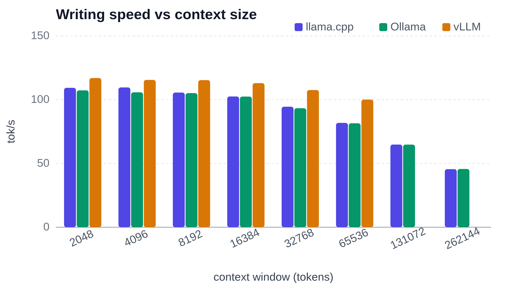
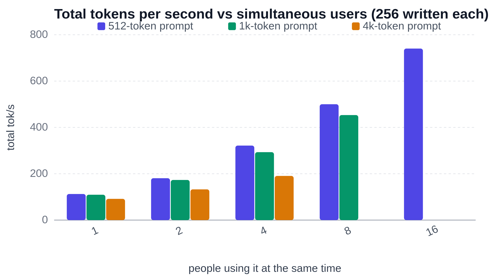

Using stock llama.cpp, qwen3.5-35b-a3b produces its first word **187 ms** after a short prompt and writes **110 tokens per second**. Hand it a 100-page book and it starts answering after 7.7 s, then writes 21 times faster than you can read. qwen3.5-35b-a3b is a dense medium mixture-of-experts model, making it interesting for VRAM-constrained systems and specialized work. It runs on a computer with two NVIDIA GeForce RTX 5060 Ti cards working together, the busiest card using about 15 GB of 16 GB VRAM. It holds a 260k-token context; electricity use for the whole computer is 0.66 kWh per 1M generated tokens.

## Straight to the Results

Verdict: qwen3.5-35b-a3b is fast on short prompts with two NVIDIA GeForce RTX 5060 Ti cards, but generation slows and waiting time increases substantially as context grows.

- Speed: **110 tokens per second** on a short prompt, falling to **46 tokens per second** at the full 260k-token context.
- Waiting: First word arrives in **187 ms** on a short prompt and **7.7 s** on a 32k-token prompt.
- Electricity: The whole computer uses **0.66 kWh per 1M generated tokens**, costing about **0.16 €**.

These results were measured with llama.cpp as it installs:

| Metric | 512 Context | 32k Context | Max Context (260k) |
| --- | --- | --- | --- |
| Prompt Processing (tok/s) | 2734 | 4274 | 2260 |
| TTFT | 187 ms | 7.7 s | 116 s |
| Generation (tok/s) | 110 | 94 | 46 |

## Which Program Should You Run It With?

The same model was run with three free programs that people use to run models at home: llama.cpp, Ollama and vLLM. Each program was installed in its standard form and used without extra setup on a computer with two identical graphics cards.

| | llama.cpp | Ollama | vLLM |
| --- | --- | --- | --- |
| Writing speed, short prompt (tok/s) | 110.1 | 107.628 | 117.024 |
| Wait for first word, short prompt | 187.249 ms | 349.359 ms | 87.145 ms |
| Wait for first word, 32k prompt | 7667.58 ms | 5741.369 ms | 5484.814 ms |
| Longest context (tokens) | 262144 | 262144 | 65536 |
| Start-up time | 2.894 s | 8.384 s | 76.702 s |
| Electricity (kWh per 1M tokens) | 0.65703 | 0.72458 | 0.83736 |

vLLM wins writing speed at **117 tok/s** and both first-word waits, although its start-up takes **77 s**. llama.cpp and Ollama tie for the longest context; llama.cpp wins start-up and electricity use for the whole computer, while Ollama leads no row. For one person on their own machine, Ollama is the easiest to set up and llama.cpp uses the least electricity; for serving several people, vLLM’s speed stands out, though it ran a different compressed version of the model (awq-AWQ-4bit rather than gguf-Q4_K_M).

## Writing Speed as the Conversation Grows

Writing speed generally falls as context grows, but vLLM holds up best: it starts at **117 token/s** at 512 tokens, reaches 108 token/s at 32k, and still manages 100 token/s at its 65536-token limit. llama.cpp drops from 110 token/s at 512 tokens to 94 token/s at 32k and 46 token/s at 262144, while Ollama closely follows at 108, 93, and 46 token/s, respectively. vLLM’s bar is missing at the largest sizes because it cannot hold that much. With the full 262144-token context, llama.cpp takes about **116 s** before the first word appears.

## When Many People Use It at Once

| context size (min / median / max) | 512 | 1024 | 4096 |
| --- | --- | --- | --- |
| Users tested | 1–16 | 1–8 | 1–4 |
| TTFT (ms) | 89 / 300 / 750 | 154 / 368 / 831 | 573 / 859 / 1687 |
| Total output (t/s) | 113 / 322 / 740 | 109 / 233 / 453 | 92 / 133 / 191 |
| Per-user output (t/s) | 54 / 89 / 117 | 70 / 90 / 117 | 70 / 86 / 115 |

Using vLLM, which shares the model across both graphics cards, the computer served 16 people at once, each sending a 512-token question and receiving a 256-token answer. Together they received **740 tokens per second**, compared with 113 tokens per second for one person using the model alone, and each still saw the first word after about **750 ms**. With 1k-token questions, 8 people were served at once and the group received 453 tokens per second in total. With 4k-token questions, 4 people were served at once and the group received 191 tokens per second in total. This means one home computer with two graphics cards can back a whole team or a small product, not just one user, depending on how long the questions are.

## The Test Bench

The hardware stays the same for every model in this series: same processor, same memory, same two graphics cards. A fixed test setup means the results can be compared directly across the different model series.

| Component | Value |
|---|---|
| CPU | Intel Core Ultra 7 265K |
| Motherboard | ASUS ROG MAXIMUS Z890 APEX Hovedkort, Intel Z890 |
| RAM | Kingston FURY Beast DDR5-5600, **64GB** |
| GPU | 2 × MSI GeForce RTX 5060 Ti (16 Gb GDDR7 each, **32 Gb in total**) |
| System | Linux 7.0.0-38-generic |
| llama.cpp version | llama.cpp@b11960 |
| Ollama version | ollama@v0.40.13 |
| vLLM version | vllm@0.33.0 |
| Model compression (llama.cpp) | gguf-Q4_K_M |
| Model compression (Ollama) | gguf-Q4_K_M |
| Model compression (vLLM) | awq-AWQ-4bit |

llama.cpp and Ollama run as they are installed and decide on their own how to spread the model over the two cards, while vLLM splits it evenly across both.

All three programs did not run the same compressed version of the model, because vLLM used awq-AWQ-4bit while llama.cpp and Ollama used gguf-Q4_K_M, so the comparison between the programs is not strictly like for like.

## Conclusion

On the two RTX 5060 Ti cards, qwen3.5-35b-a3b produced responses in 187 ms to 116 s, with the slowest result at 262k tokens, and decoding speeds of 110 tok/s to 46 tok/s. Whole-computer energy use was 0.66 kWh per 1M generated tokens. On a short prompt, vLLM reached 117 tok/s, compared with 110 tok/s for llama.cpp and 108 tok/s for Ollama; vLLM also served 16 users at 740 tok/s in total. For one person, I would pick vLLM at **117 tok/s** on a short prompt; for several people, I would pick vLLM, which delivered **740 tok/s** in total to 16 users.

## Further reading

**Every number, chart and caveat:** [the complete analysis](https://bench.auralis-lab.com/qwen3-5-35b-a3b-on-two-geforce-rtx-5060-ti-260k-token-context-no-tuning/).
