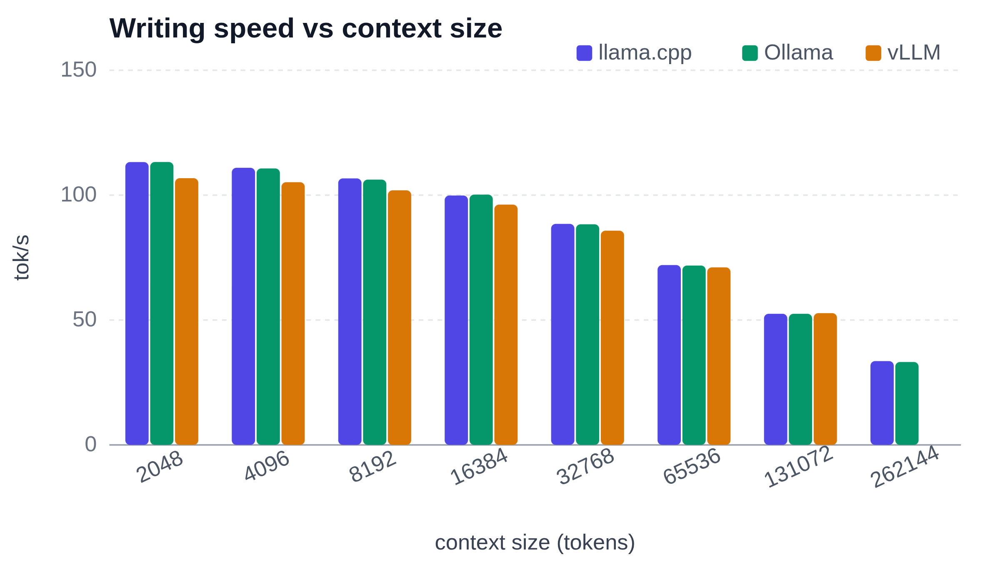
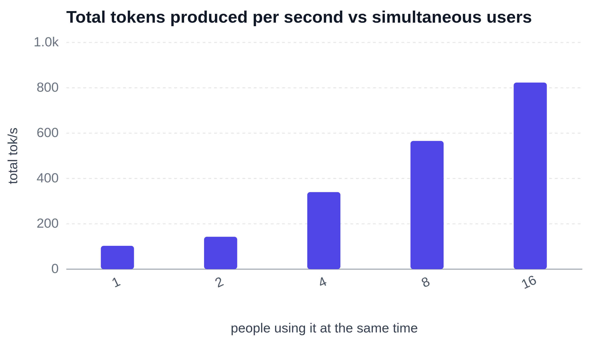

With stock llama.cpp, qwen3.5-4b writes **114 tokens per second** on a short prompt and shows its first word after **101 ms**. Hand it a 100-page book and it starts answering after 6.5 s, then writes 21 times faster than you can read. Qwen3.5-4b is a small language model, a size that can be interesting to run on mobile or edge devices. It holds a 262144-token context using 12253 MB of the card’s 16311 MB and uses 0.63 kWh per 1M generated tokens. Every program was tested exactly as it installs, with no tuning, on an NVIDIA GeForce RTX 5060 Ti.

## Straight to the Results

Qwen3.5-4b on an NVIDIA GeForce RTX 5060 Ti is a niche choice for classification tasks and edge inference, with long contexts sharply reducing speed.

- Speed: **114 tokens per second** on a short prompt, falling to 34 tokens per second at the full 262144-token context.
- Waiting: the first word arrives in **101 ms** on a short prompt, compared with 6.5 s on a 32k-token prompt.
- Electricity: **0.63 kWh per 1M generated tokens**, costing about 0.16 €.

Measured with llama.cpp, as it installs:

| Metric | 512 Context | 32k Context | Max Context (262144) |
| --- | --- | --- | --- |
| Prompt Processing (tok/s) | 5050.03 | 5031.2 | 1945.92 |
| TTFT | 101.386 ms | 6512.955 ms | 134549.977 ms |
| Generation (tok/s) | 113.757 | 87.978 | 33.557 |

## Which Program Should You Run It With?

The same model was run with three free programs people use to run models at home: llama.cpp, Ollama and vLLM. Each was used exactly as it installs.

| | llama.cpp | Ollama | vLLM |
| --- | --- | --- | --- |
| Writing speed, short prompt (tok/s) | 113.757 | 113.619 | 107.4 |
| Wait for first word, short prompt | 101.386 ms | 164.781 ms | 101.443 ms |
| Wait for first word, 32k prompt | 6512.955 ms | 7267.49 ms | 7543.24 ms |
| Longest context (tokens) | 262144 | 262144 | 256000 |
| Start-up time | 1.027 s | 4.745 s | 47.641 s |
| Electricity (kWh per 1M tokens) | 0.62608 | 0.65178 | 0.52414 |

llama.cpp wins writing speed, both waits for the first word and start-up, and ties Ollama for the longest context, making it the strongest choice here for one person; Ollama is nearly as fast and is the pick for the easiest install. vLLM uses the least electricity at **0.52 kWh per 1M tokens**, but takes **48 s** to start, and is the pick for serving several people. One caution: vLLM uses a different compressed version of the model, awq-AWQ-4bit, while the other two use gguf-Q4_K_M.

## Writing Speed as the Conversation Grows

Writing speed falls sharply as context grows: llama.cpp drops from **114 tokens per second** at 512 tokens to 88 at 32k, then **34 tokens per second** at full context. Ollama nearly matches llama.cpp throughout, ending at 33 tokens per second. vLLM is slightly slower at the two smaller contexts, with 107 and 86 tokens per second, but slightly faster at its own maximum, reaching 36. vLLM’s bar is missing at the largest size because it cannot hold that much context. At full context, llama.cpp takes about 135 s before the first word appears.

## When Many People Use It at Once

So far, every number has described one person using the model alone. With vLLM, a program built for sharing, the same computer serves 16 people at once, delivering **823 tokens per second** in total instead of 103 for one person. Each of them still sees the first word after about **1.2 s**. One budget computer can back a whole team or a small product, not just one user.

## The Test Bench

The hardware will remain unchanged throughout the entire series. This will make the results more comparable between different model series.

| Component | Specification |
|---|---|
| CPU | Intel Core Ultra 7 265K |
| Motherboard | ASUS ROG MAXIMUS Z890 APEX Hovedkort - Intel Z890 |
| RAM | Kingston FURY Beast DDR5-5600 - 64GB (32 Gb) |
| GPU | MSI GeForce RTX 5060 Ti (16 Gb GDDR7) |
| System | Linux 7.0.0-38-generic |
| llama.cpp version | llama.cpp@b11960 |
| Ollama version | ollama@v0.40.13 |
| vLLM version | vllm@0.27.1 |
| Model compression (llama.cpp) | gguf-Q4_K_M |
| Model compression (Ollama) | gguf-Q4_K_M |
| Model compression (vLLM) | awq-AWQ-4bit |

The three programs did not all run the same compressed version of the model: llama.cpp and Ollama used gguf-Q4_K_M, while vLLM used awq-AWQ-4bit, so the comparison between programs is not strictly like for like.

## Conclusion

On a budget computer with an NVIDIA GeForce RTX 5060 Ti, qwen3.5-4b is usable, with response times from 101 ms to 135 s—the latter at 262144 tokens—and decoding speeds from 34 to **114 tokens per second**. Energy consumption is **0.63 kWh per 1M generated tokens**. For short-prompt writing, llama.cpp reaches 114 tokens per second, Ollama 114, and vLLM 107; with several people at once, vLLM serves 16 users at 823 tokens per second in total. For one person, I would pick llama.cpp; for several people, vLLM.

## Further reading

Complete benchmark article: {{COMPLETE_BENCHMARK_ARTICLE_URL}}

Previous article in the series: {{PREVIOUS_ARTICLE_URL}}

Next article in the series: {{NEXT_ARTICLE_URL}}
