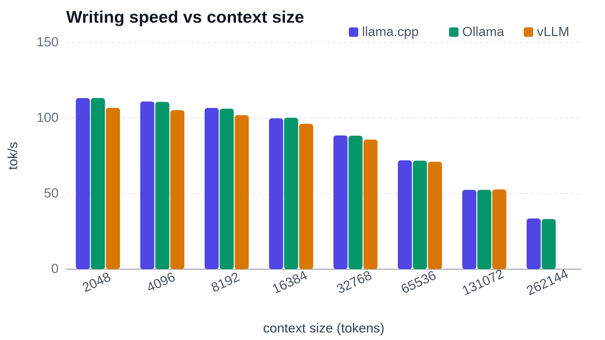
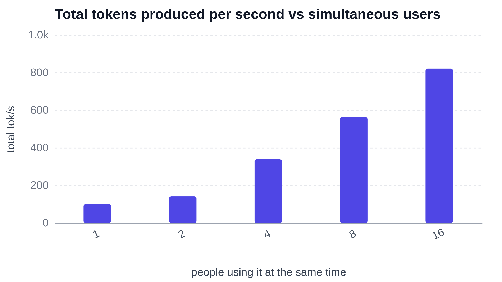

With stock llama.cpp, qwen3.5-4b delivers **114 tokens per second**, with the first word appearing in **101 ms**. Hand it a 100-page book and it starts answering after 6.51 s, then writes 21 times faster than you can read. The model holds a 260k-token context using 12 GB of the card’s 16 GB and uses 0.63 kWh per 1M generated tokens. qwen3.5-4b is a 4-billion-parameter language model in the small (<8B) class, and models at that size can be interesting to run on mobile or at the edge.

## Straight to the Results

Verdict: qwen3.5-4b is quick on an NVIDIA GeForce RTX 5060 Ti for short prompts, but long-context use is much slower and involves longer waits.

- Speed: **114 tokens per second** on a short prompt, dropping to **34 tokens per second** at the full 260k-token context.
- Waiting: The first word arrives in **101 ms** on a short prompt and takes **6.5 s** on a 32k-token prompt.
- Electricity: **0.63 kWh per 1M generated tokens**, costing about **€0.16**.

The table shows measurements taken with llama.cpp using its standard installation.

| Metric | 512 Context | 32k Context | Max Context (260k) |
| --- | --- | --- | --- |
| Prompt Processing (tok/s) | 5050 | 5031 | 1946 |
| TTFT | 101 ms | 6.5 s | 134.5 s |
| Generation (tok/s) | 114 | 88 | 34 |

## Which Program Should You Run It With?

The same model was run with three free programs people use at home: llama.cpp, Ollama, and vLLM, each set up with its standard installation. The table compares writing speed, first-word delay, context length, start-up time, and electricity use.

| | llama.cpp | Ollama | vLLM |
| --- | --- | --- | --- |
| Writing speed, short prompt (tok/s) | 113.757 | 113.619 | 107.4 |
| Wait for first word, short prompt | 101.386 ms | 164.781 ms | 101.443 ms |
| Wait for first word, 32k prompt | 6512.955 ms | 7267.49 ms | 7543.24 ms |
| Longest context (tokens) | 262144 | 262144 | 256000 |
| Start-up time | 1.027 s | 4.745 s | 47.641 s |
| Electricity (kWh per 1M tokens) | 0.62608 | 0.65178 | 0.52414 |

llama.cpp narrowly wins writing speed (**114 tok/s**) and both first-word waits (vLLM is effectively tied on the short prompt), and it starts fastest in 1.0 s; llama.cpp and Ollama tie for longest context at 260k tokens, while vLLM uses the least electricity at **0.52 kWh per 1M tokens**, leaving Ollama without an outright row win. For one person on their own machine, Ollama is the easiest to install and llama.cpp is the strongest all-round choice in these measurements; for serving several people, vLLM's server design is the better fit, although its **48 s** start-up is much slower and the table does not test multi-user serving. vLLM ran the awq-AWQ-4bit compressed version of the model, while llama.cpp and Ollama ran gguf-Q4_K_M, so the programs were not tested with identical model files.

## Writing Speed as the Conversation Grows

Decode speed is remarkably flat until the context gets large: from 512 to 32k tokens llama.cpp loses only about a quarter of its pace, and Ollama matches it almost exactly at every size (114 and 88 tokens per second at the two small sizes, 33 and 34 tokens per second at the very top), so on raw throughput the two are interchangeable. Beyond 32k, however, all three fall off a cliff — llama.cpp ends up roughly **3.4x slower** than at 512 tokens, and the memory needed to hold the KV cache starts to bite. vLLM starts out slightly behind at 107 tokens per second but degrades more gracefully, and at its own ceiling it still runs at **36 tokens per second**, about 6% ahead of llama.cpp and 7% ahead of Ollama; its bar is missing at the largest size because it cannot hold quite as much context.

The wait before the first word at full context, around **135 s**, is essentially the time needed to chew through the 262k-token prompt at 1946 tokens per second, with the card spending 12 GB of its 16 GB on the cache — so a long prompt, not a slow model, is what you are waiting for.

## When Many People Use It at Once

With vLLM, a program designed for sharing, one computer can serve **16 people at the same time**. Together, they receive **823 tokens per second**, compared with **103 tokens per second** for one person alone, and each still sees the first word after about **1210 ms**. One budget computer can back a whole team or a small product, not just one user.

## The Test Bench

The hardware stays identical for every model in this series, so each result is measured on the same machine. That makes the numbers directly comparable from one model to the next, and it makes it possible to tell apart how much of a score change comes from the model itself rather than from different hardware.

| Component | Details |
|---|---|
| CPU | Intel Core Ultra 7 265K |
| Motherboard | ASUS ROG MAXIMUS Z890 APEX Hovedkort - Intel Z890 |
| RAM | Kingston FURY Beast DDR5-5600 - 64GB (32 Gb) |
| GPU | MSI GeForce RTX 5060 Ti (16 Gb GDDR7) |
| System | Linux 7.0.0-38-generic |
| llama.cpp version | llama.cpp@b11960 |
| Ollama version | ollama@v0.40.13 |
| vLLM version | vllm@0.27.1 |
| Model compression (llama.cpp) | gguf-Q4_K_M |
| Model compression (Ollama) | gguf-Q4_K_M |
| Model compression (vLLM) | awq-AWQ-4bit |

The three programs did not all run the same compressed version of the model: llama.cpp and Ollama both used gguf-Q4_K_M, while vLLM used awq-AWQ-4bit, so the comparison between programs is not strictly like for like.

## Conclusion

On a budget machine with an NVIDIA GeForce RTX 5060 Ti, qwen3.5-4b is practical for everyday use. The first token arrives in **101 ms**, and short-prompt decoding reaches **113.757 tok/s** under llama.cpp, with Ollama matching it at **113.619 tok/s** and vLLM slightly behind at **107.4 tok/s**, so the gap between the three backends on a single short prompt is about 6 tok/s. At the far end of the test, a 262144-token run takes **134.5 s** and the lowest decoding speed recorded is **33.557 tok/s**, which is still fast enough to read the output as it streams rather than waiting. The energy cost is **0.63 kWh per 1M generated tokens**, low enough that electricity is not the reason to limit usage. Running several people at once works as well: vLLM served 16 concurrent users at **823.238 tok/s** in total on the same card.

For one person I would pick llama.cpp, since it posts the highest decoding speed and the shortest response time here, and for several people at once I would pick vLLM, which handled 16 users at 823.238 tok/s in total.

## Further reading

**Every number, chart and caveat:** [the complete analysis](https://bench.auralis-lab.com/qwen3-5-4b-on-a-16-gb-rtx-5060-ti-260k-token-context-in-12-gb/).
