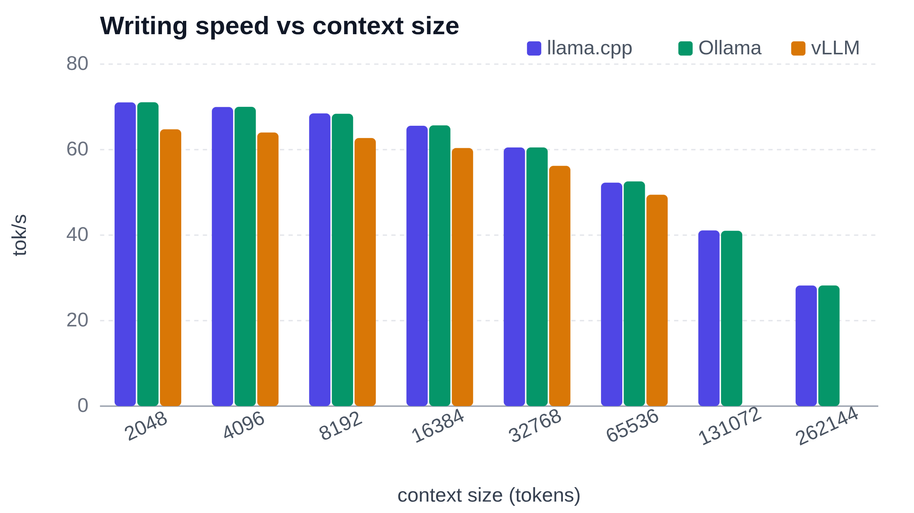
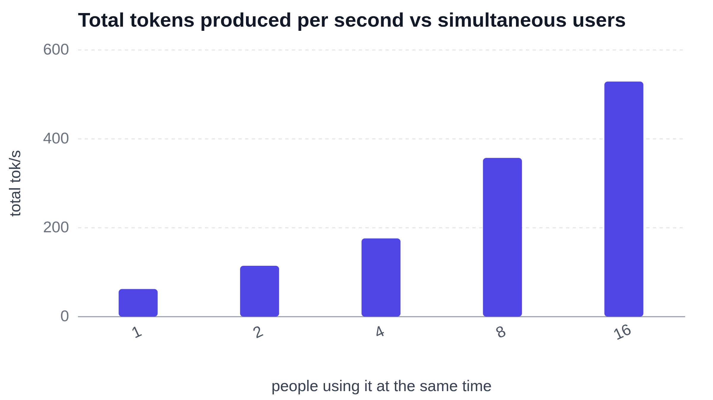

Qwen3.5-9B writes **71** tokens per second on a short prompt, with the first word appearing after **164** ms. Hand it a 100-page book and it starts answering after 10 s, then writes 13 times faster than you can read. It is a 9-billion-parameter language model, just below the medium-size range where analysis and general knowledge start to become more compelling. It holds 260k tokens of context using 15 GB of the card’s 16 GB.

## Straight to the Results

qwen3.5-9b on an NVIDIA GeForce RTX 5060 Ti is fast with short prompts, but longer contexts reduce speed and increase waiting time.

- Speed: **71 tokens per second** on a short prompt, falling to **28 tokens per second** at the full 260k-token context.
- Waiting: first word in **164 ms** on a short prompt, versus **10 s** on a 32k-token prompt.
- Electricity: **1.0 kWh per 1M generated tokens**, costing about **€0.26**.

The table below shows measurements taken with llama.cpp as installed.

| Metric | 512 Context | 32k Context | Max Context (260k) |
| --- | --- | --- | --- |
| Prompt Processing (tokens per second) | 3131 | 3200 | 1588 |
| Time to first word | 164 ms | 10 s | 2.7 min |
| Generation (tokens per second) | 71 | 60 | 28 |

## Which Program Should You Run It With?

The same model was run with three free programs people use to run models at home: llama.cpp, Ollama and vLLM. Each was run exactly as it installs.

| | llama.cpp | Ollama | vLLM |
| --- | --- | --- | --- |
| Writing speed, short prompt (tok/s) | **71** | **71** | 65 |
| Wait for first word, short prompt | **164** ms | 226 ms | 179 ms |
| Wait for first word, 32k prompt | **10** s | 10 s | 12 s |
| Longest context (tokens) | **260k** | **260k** | 66k |
| Start-up time | **1.3** s | 5.1 s | 1.9 min |
| Electricity (kWh per 1M tokens) | 1.0 | 1.1 | **0.90** |

llama.cpp narrowly wins writing speed, wins both first-word waits and start-up time, and ties Ollama for longest context; vLLM uses the least electricity. For one person on their own machine, these results favor llama.cpp; consider Ollama for an easier installation, or vLLM for serving several people, though the table does not measure that use. vLLM uses a different compressed version of the model, awq-AWQ-4bit, rather than the gguf-Q4_K_M version used by the other two.

## Writing Speed as the Conversation Grows

llama.cpp’s writing speed falls from **71** tokens per second at 512 tokens of context to 60 at 32k and **28** at 260k. Ollama matches it at every tested size, while vLLM is slightly slower at the shared sizes, reaching 65 and 56 tokens per second. vLLM’s bar is missing at the largest sizes because its 66k-token limit cannot hold that much context. At full context, llama.cpp takes about 2.7 minutes to show the first word.

## When Many People Use It at Once

Until now, all figures were measured with one person using the model alone. With vLLM, a program built for sharing, the same computer serves 16 people at once: together they receive **529** tokens per second instead of **62** for one person alone. Each person still sees the first word after about 2.2 seconds. One budget computer can back a whole team or a small product, not just one user.

## The Test Bench

The hardware will remain unchanged throughout the entire series. This will make results more comparable across different model series.

| Component | Specification |
|---|---|
| CPU | Intel Core Ultra 7 265K |
| Motherboard | ASUS ROG MAXIMUS Z890 APEX Hovedkort - Intel Z890 |
| RAM | Kingston FURY Beast DDR5-5600 - 64GB (32 Gb) |
| GPU | MSI GeForce RTX 5060 Ti (16 Gb GDDR7) |
| System | Linux 7.0.0-38-generic |
| llama.cpp version | llama.cpp@b11960 |
| Ollama version | ollama@v0.40.13 |
| vLLM version | vllm@0.27.1 |
| Model compression (llama.cpp) | gguf-Q4_K_M |
| Model compression (Ollama) | gguf-Q4_K_M |
| Model compression (vLLM) | awq-AWQ-4bit |

The three programs did not run the same compressed version of the model: llama.cpp and Ollama used gguf-Q4_K_M, while vLLM used awq-AWQ-4bit, so the comparison between programs is not strictly like for like.

## Conclusion

Qwen3.5-9B on a budget computer with an NVIDIA GeForce RTX 5060 Ti generates 28 to **71** tokens per second, with energy consumption of 1.0 kWh per 1M generated tokens. Response times range from 164 ms to 2.7 minutes, with the longest delay at 260k tokens. For short prompts, llama.cpp and Ollama both reach about 71 tokens per second, compared with 65 for vLLM. For shared use, vLLM serves **16** users at 529 tokens per second in total. I would pick llama.cpp for one person because it has the highest measured short-prompt speed, and vLLM for several people because it serves 16 users at once.

## Further reading

**Every number, chart and caveat:** [the complete analysis](https://bench.auralis-lab.com/qwen3-5-9b-on-geforce-rtx-5060-ti-260k-token-context-entirely-in-vram/).
